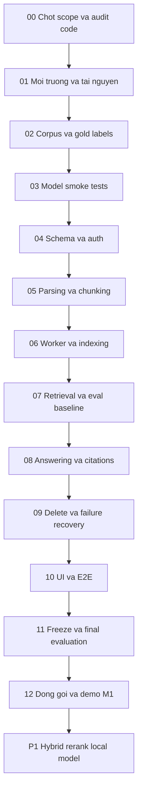

# PLAN — SME Knowledge Copilot

> **Phiên bản:** 1.4 — Bước 02 có artifacts kỹ thuật, chờ human review, 02/11/2026 (lập kế hoạch 01/11/2026)<br>
> **Nguồn yêu cầu:** [SME_Knowledge_Copilot_RAG_Specification.md](SME_Knowledge_Copilot_RAG_Specification.md), v2.1  
> **Mục tiêu:** hoàn thành project RAG thuần có demo, test và benchmark tái lập; hướng tới M1 ngày 15/11/2026.  
> **Nhân sự:** 2 người. Kế hoạch theo thứ tự phụ thuộc; thời lượng là ước lượng, không phải cam kết.  
> **Trạng thái:** hoàn thành Bước 00/01; Bước 02 đạt 6/7 đầu việc, chờ hai người kiểm tra nhãn; Bước 03–12 chưa thực hiện. Chưa tải model, gọi inference hoặc chạy benchmark chất lượng.<br>

**Tiến độ hiện tại: 11,2% / 100%.** [Bước 02](docs/dataset-step02.md) đã có 10 tài liệu giả lập, 45 câu nháp (15 dev/30 test, 6 unanswerable), 8 fixtures và 37 eval tests đạt; **0/45 câu được hai người duyệt**, chưa có human gold/benchmark. [Bước 01](docs/environment-step01.md) hoàn thành baseline 64 tests và môi trường. [Audit Bước 00](docs/rag-transition-audit.md) giữ lịch sử; [KNOWLEDGE.md](KNOWLEDGE.md) ghi lý do/kết quả. Ngân sách **0 USD/free tier**. Không tự bắt đầu Bước 03 khi chưa có xác nhận đợt riêng.

### Quy ước báo tiến độ project

Mỗi phản hồi cuối báo **X% / 100%**, theo yêu cầu người dùng 02/11/2026. Dùng midpoint person-hours của bảng Bước 00–12 làm trọng số cố định ban đầu: `1,5; 4; 7; 5; 8; 12; 10; 10; 10; 10; 12; 8; 5`, tổng **102,5**. Công thức `100 × Σ(trọng số bước × tỷ lệ đầu việc đã xác minh) / 102,5`; làm tròn một chữ số thập phân. Sửa trọng số cần ghi lý do và phiên bản, không đổi để làm % đẹp hơn.

| Bước | Trọng số | Phần đã ghi nhận | Đóng góp quy đổi |
|---|---:|---:|---:|
| 00 | 1,5 | 100% — audit/hướng dẫn | 1,5 |
| 01 | 4 | 100% — môi trường/baseline, quota thật là gate trước smoke | 4 |
| 02 | 7 | 6/7 đầu việc; mục 5 chờ gán/kiểm tra chéo bởi hai người | 6 |
| 03–12 | 90 | 0% | 0 |
| Tổng | 102,5 | `(1,5 + 4 + 6) / 102,5` | **11,2% / 100%** |

Đầu việc đang làm/chưa xác minh không tính hoàn thành; đóng gate còn cần các điều kiện của từng bước. Cách chia đều đầu việc trong một bước là ước lượng quản lý, không phải giờ thực tế đã tiêu hay độ chính xác AI. Nếu chỉ giải thích/đọc, giữ nguyên %; chỉ ghi file tiến độ trong đợt thay đổi đã xác nhận. Bước 02 đủ 7/7 sẽ đưa tổng lên khoảng 12,2%, nhưng hiện chưa đạt.

## 1. Phương án khởi đầu

**Với máy hiện tại, nên bắt đầu bằng embedding local nhẹ trên CPU và LLM hosted.** Xây corpus, đánh giá retrieval và citation trước khi đầu tư vào model lớn, GPU hoặc giao diện hoàn chỉnh.

| Thành phần | Lựa chọn khởi đầu | Khi nào xem lại |
|---|---|---|
| Embedding | `intfloat/multilingual-e5-small`, CPU | So với `BAAI/bge-m3` trên dev set và cùng máy |
| Generation | Thử `gemini-3.5-flash-lite` qua adapter; xác nhận quyền truy cập tài khoản | So với `gemini-3.6-flash` nếu câu trả lời với gold context vẫn yếu |
| Retrieval | Dense-only, Qdrant, filter + SQL revalidation | Hybrid/reranker sau baseline M1 |
| Metadata | PostgreSQL, Alembic, worker lease/retry | Không thêm queue/service nếu chưa có nhu cầu cụ thể |
| Parsing | PyMuPDF, python-docx, TXT/MD UTF-8 | OCR và layout phức tạp ngoài M1 |
| Evaluation | Gold evidence + human review + scripts | Judge tự động chỉ là bổ sung P1 |
| Runtime | Dev: DB/Qdrant trong Docker, API/worker/frontend trên host; cuối M1 đóng gói Compose | Chỉ đổi topology nếu đo cho thấy thiếu tài nguyên |

Đây là **cấu hình để bắt đầu thử nghiệm**, chưa phải kết luận model tốt nhất. Spec cho phép benchmark model nhỏ hơn BGE-M3; sau khi chọn phải đồng bộ model, dimension, chunk config và index manifest, không giữ cấu hình 1024 chiều của BGE khi dùng E5.

Không fine-tune, không agent, không STT, không tự động tạo task trong kế hoạch M1/M2 RAG. Giá trị AI cần chứng minh là: dữ liệu được xử lý đúng, retrieval đo được, câu trả lời có nguồn và biết giới hạn bằng chứng.

## 2. Điểm xuất phát trong repository

Khảo sát ngày 01/11/2026 cho thấy repo vẫn là skeleton của hướng Operations:

| Thành phần đã thấy | Có thể tận dụng | Công việc còn thiếu cho RAG |
|---|---|---|
| `backend/pyproject.toml`, app FastAPI, config/DB/error handling | Khung backend, SQLAlchemy, Alembic, Ruff, pytest | Dependencies và services RAG; chuẩn lỗi/envelope theo spec mới |
| `backend/app/models/workspace.py` | Workspace/user identity và các mixin | User hiện có email; cần mapping login/username, role knowledge_admin và migration rõ ràng |
| API router | Health endpoint | Chưa có auth endpoint/RAG routes trong router đã kiểm tra |
| `compose.yaml` | PostgreSQL, backend image, storage volume | Chưa có Qdrant/worker đang cấu hình chạy; chưa kiểm chứng Docker daemon |
| Frontend React/TypeScript/Vite | Router, styles, API client, backend status | Màn hình hiện là placeholder Operations; cần Documents/Chat/Source Preview |
| Tests hiện có | API basics, schema constraints cũ | Không phải bộ nghiệm thu RAG |
| `eval/README.md` | Thư mục đánh giá | Nội dung còn hướng STT, chưa có benchmark RAG |
| `CLAUDE.md`, README | Conventions và hướng dẫn ban đầu | Còn mâu thuẫn với hướng RAG, phải đồng bộ ở bước 00 |

Không coi bảng `users` có `password_hash` là bằng chứng auth đã hoạt động. Không coi image PostgreSQL có pgvector là đã có retrieval. Chỉ đánh dấu tính năng hoàn thành sau test tương ứng.

Tại thời điểm lập v1.0 chỉ thêm PLAN.md. Trong Bước 00 ngày 02/11/2026 đã đồng bộ CLAUDE/AGENTS/README/eval/ADR instructions, thêm audit và cập nhật KNOWLEDGE; code/schema/dependencies/hạ tầng vẫn giữ baseline cũ. Bảng khảo sát 01/11 ở trên là dữ liệu lịch sử; trạng thái hiện tại xem audit. Spec là nguồn business rules; PLAN quy định thứ tự, lựa chọn thí nghiệm và cách kiểm chứng.

## 3. Cấu hình máy và cách bố trí tài nguyên

### 3.1. Máy đang dùng

Thông tin dưới đây đọc từ Windows, không phải benchmark inference:

| Hạng mục | Quan sát | Tác động đến kế hoạch |
|---|---|---|
| CPU | Intel Core i7-1165G7, 4 cores / 8 logical processors | Embedding CPU là đường chạy thực tế; tránh nhiều tiến trình inference tranh CPU |
| RAM vật lý | Khoảng 15,7 GiB, tương đương máy RAM 16 GB | Cần tính cả Windows, IDE, Docker, API và worker |
| GPU được hệ thống báo | Intel Iris Xe Graphics; không thấy NVIDIA trong kết quả khảo sát | Không lập kế hoạch dựa trên CUDA/GPU rời |
| Ổ C | Còn khoảng 8,9 GiB | Ưu tiên xử lý chỗ trống trước tải dependencies/model/images |
| Ổ D | Còn khoảng 80,0 GiB | Ứng viên đặt model cache và dữ liệu dev |
| Ổ E | Còn khoảng 90,3 GiB | Phương án thay thế cho cache/artifacts |

Dung lượng là ảnh chụp tại thời điểm đọc, sẽ thay đổi. Không dùng trường Windows `AdapterRAM` để kết luận Iris Xe có VRAM riêng dùng cho LLM. Không suy ra các phân vùng D/E là ổ vật lý khác hoặc SSD nhanh hơn C.

**Quyết định cho M1:** không cần mua GPU để bắt đầu; chưa nên lấy local LLM làm đường chạy chính. Nếu sau đo CPU retrieval đạt nhu cầu, GPU không phải điều kiện hoàn thành portfolio này.

### 3.2. Ngân sách RAM khởi đầu

Đây là ngân sách lập kế hoạch, phải thay bằng số đo RSS/working set thật:

| Nhóm | Mức dành chỗ dự kiến | Ghi chú |
|---|---|---|
| Windows + IDE + browser | 5–6 GiB | Giảm tab và ứng dụng nền khi benchmark |
| PostgreSQL + Qdrant + Docker/WSL | 2–3 GiB | Đo tổng VM/container, tránh cộng trùng cùng một vùng nhớ |
| API + worker + embedding + frontend dev | 3–4 GiB | Bao gồm khả năng hai process load hai bản model |
| Dự phòng | Ít nhất 2 GiB | Không xem swap liên tục là trạng thái ổn định |

Bắt đầu 1 ingestion worker, 1 query đồng thời khi đo, embedding batch 4; thử batch 8 chỉ khi đủ RAM. Giới hạn số threads inference, thử 2 rồi 4 và đo thay vì để mọi process tự lấy toàn bộ logical CPUs. Hạn mức 2 LLM calls đồng thời của spec là trần ban đầu, không bắt buộc phải dùng hết.

Nếu RAM vượt khoảng 85% kéo dài hoặc máy paging mạnh: giảm batch/concurrency, tắt local LLM, tránh load BGE-M3 cùng E5, rồi đo lại. Đây là ngưỡng cảnh báo vận hành đề xuất, không phải SLA.

### 3.3. Ổ đĩa, cache và Windows/Docker

1. Trước cài thư viện AI, kiểm tra chỗ trống của ổ chứa virtualenv, cache và Docker disk image. Mục tiêu dành tối thiểu 20–30 GiB cho môi trường/dependencies/images và khoảng 10 GiB cho thử nghiệm model ban đầu; đây là dự phòng, không phải dung lượng download đã đo.
2. Đề xuất cache ở `D:\AI-Cache\huggingface`; cấu hình biến `HF_HOME` trước import thư viện. Chỉ lưu tokenizer/weights của model/revision cần thử, không clone toàn bộ mọi định dạng checkpoint. Cơ chế `HF_HOME` được mô tả trong [Hugging Face environment variables](https://huggingface.co/docs/huggingface_hub/package_reference/environment_variables).
3. Kiểm tra riêng Docker data location và giới hạn WSL2. Chỉ đổi đường dẫn/cache model không làm Docker virtual disk chuyển khỏi C. Việc di chuyển Docker data phải theo hướng dẫn hỗ trợ của phiên bản đang dùng, có backup; không kéo thả/xóa VHDX thủ công. [Docker Desktop settings](https://docs.docker.com/desktop/settings-and-maintenance/settings/).
4. Repo hiện ở C; `.venv`, pip/npm cache và build layers vẫn có thể làm đầy C. Nếu cần chuyển workspace/env sang D, thực hiện như một thay đổi riêng có kiểm tra, không tự xóa bản gốc.
5. Dev trên host dùng DB port `localhost:5433`; container dùng hostname `db:5432`. Qdrant dev dự kiến `localhost:6333`, container dùng `qdrant:6333`. Không trộn hai kiểu URL trong cùng profile.
6. Khi container cần model cache trên host, mount cache và đặt biến môi trường bằng **đường dẫn trong container**, không dùng trực tiếp `D:\...` trong Linux container.
7. Pin Python runtime và lockfiles hiện có trước khi thêm thư viện. Cài PyTorch CPU theo hướng dẫn chính thức tại thời điểm cài; không tải CUDA toolkit chỉ vì đang làm AI.

Không có thao tác di chuyển cache, cài runtime hay thay đổi Docker được thực hiện trong lần viết kế hoạch này.

### 3.4. Nếu đổi sang máy khác

| Cấu hình tham khảo | Hướng triển khai nên thử | Giới hạn cần kiểm chứng |
|---|---|---|
| 8 GB RAM, CPU-only | Embedding nhẹ + hosted LLM; tối giản process | Có thể không đủ cho toàn stack; cân nhắc máy/DB dev khác trước cài nặng |
| 16 GB RAM, CPU-only — máy hiện tại | E5 CPU + hosted LLM | Đo query embedding latency và hai bản model API/worker |
| 32 GB RAM, CPU-only | Có dư địa thử BGE và local LLM nhỏ tuần tự | RAM lớn hơn không tự làm decoding CPU đủ nhanh |
| 16–32 GB RAM + GPU 8 GB VRAM | Thử một model quantized nhỏ, hoặc dùng GPU cho embedding | Context/KV cache và model chạy đồng thời có thể gây OOM |
| 32 GB RAM + GPU 12–16 GB VRAM | Nhiều dư địa thử 4B/8B quantized và reranker | Vẫn phải benchmark tiếng Việt, JSON, citation và RAM/VRAM |

Các cấu hình này là nhánh thử nghiệm, không phải khuyến nghị mua phần cứng hay bảo đảm một model sẽ chạy vừa. Chỉ cân nhắc thuê GPU ngắn hạn khi đã có script benchmark và câu hỏi cần trả lời bằng phép đo.

## 4. Chọn model và cấu hình AI

### 4.1. Embedding: bắt đầu nhỏ, so sánh có kiểm soát

| Candidate | Thông số từ model card | Vai trò trong project |
|---|---|---|
| `intfloat/multilingual-e5-small` | 384 chiều; input tối đa 512 tokens; cần prefix `query: ` / `passage: `, kể cả tiếng Việt | Baseline CPU đầu tiên. [Model card](https://huggingface.co/intfloat/multilingual-e5-small) |
| `BAAI/bge-m3` | 1024 chiều; sequence length 8192; có dense/sparse/multi-vector; không cần query instruction như một số BGE khác | Challenger; M1 chỉ thử dense. [Model card](https://huggingface.co/BAAI/bge-m3) |

**Cấu hình thí nghiệm đề xuất:**

- E5: chunk target 350 tokens, overlap 50 theo tokenizer embedding; đếm thêm heading, prefix và special tokens. Assert input không vượt giới hạn trước encode; không để thư viện âm thầm truncate điều kiện chính sách.
- BGE: lần thử riêng bắt đầu chunk 500/overlap 75 như spec; chưa dùng context dài tối đa chỉ vì model hỗ trợ.
- CPU: bắt đầu FP32 để có baseline đơn giản. ONNX/OpenVINO hoặc quantization chỉ thử sau khi có số đo và đối chiếu retrieval; không đổi runtime + chunker + model cùng lúc rồi quy hết cải thiện cho model.
- Model adapters tách `embed_query` và `embed_documents`; normalize theo cấu hình pin; collection metric cosine. Vector dimension/fingerprint phải được kiểm tra lúc startup.
- Không trộn vector hai model hoặc revision khác nhau trong cùng collection; tên thí nghiệm dự kiến `knowledge_e5_small_v1` và `knowledge_bge_m3_v1`.
- Muốn so **chỉ model**, dùng cùng các source-span chunks có độ dài hợp lệ cho cả hai tokenizer. So E5-350 với BGE-500 là so cả pipeline, phải ghi đúng tên thí nghiệm.

**Quy tắc chọn:** đầu tiên loại cấu hình OOM, truncate âm thầm hoặc không tái lập. Sau đó so dev Hit@5/Recall@5, query latency, ingestion throughput, peak RAM và lỗi theo nhóm câu hỏi. Nếu chênh lệch chất lượng nhỏ/không rõ trên tập ít mẫu, ưu tiên cấu hình đơn giản hơn; không suy ra BGE chắc chắn tốt hơn chỉ từ kích thước.

### 4.2. LLM sinh câu trả lời: hosted trước

Shortlist được đối chiếu tài liệu nhà cung cấp ngày 01/11/2026:

| Candidate | Cách dùng đề xuất | Điều kiện chọn |
|---|---|---|
| `gemini-3.5-flash-lite` | Hosted baseline; model code stable, có structured outputs | Đạt smoke test JSON/citation/abstention trên dev. [Tài liệu model](https://ai.google.dev/gemini-api/docs/models/gemini-3.5-flash-lite) |
| `gemini-3.6-flash` | Hosted challenger trên cùng gold context | Chỉ đổi mặc định nếu chất lượng/độ trễ/chi phí thực đo phù hợp. [Tài liệu model](https://ai.google.dev/gemini-api/docs/models/gemini-3.6-flash) |

Danh sách trên không khẳng định quyền truy cập của tài khoản đã có, hoặc đây là hai model tốt nhất. Trước khi chốt, kiểm tra endpoint, quota, giá, vòng đời model và yêu cầu lưu trữ dữ liệu của tài khoản. Nếu model không khả dụng, chọn một model text stable khác rồi chạy lại cùng smoke set; không đổi âm thầm trong eval run.

Giữ `LLMProvider` theo adapter trong spec. Gemini có endpoint tương thích tại `https://generativelanguage.googleapis.com/v1beta/openai/`; cần smoke-test structured schema, usage, timeout và tham số cụ thể, không giả định mọi provider tương đương. Đây là endpoint **Google**, không phải sử dụng dịch vụ OpenAI. [Gemini compatibility](https://ai.google.dev/gemini-api/docs/openai).

**Cấu hình ứng dụng khởi đầu:**

- Evidence budget 4.000 tokens, output target 800 tokens, safety margin 256; đếm theo tokenizer/cơ chế counting phù hợp provider. Không dùng token count E5 thay cho LLM.
- Cap context vận hành ở mức đủ cho pipeline, ví dụ 8.192 tokens; đây là giới hạn ứng dụng tự đặt, không phải context tối đa công bố của model hosted.
- Tắt built-in web search, file search, code execution và tools. Model chỉ tổng hợp text do retrieval của project cung cấp; không upload toàn PDF để provider thay luôn RAG pipeline.
- Pin prompt/schema version và decoding settings model hỗ trợ. Không ép một temperature cho mọi model; ưu tiên cấu hình được hỗ trợ và ghi lại chính xác.
- Đặt thinking ở mức thấp phù hợp khi API hỗ trợ; đo billed usage thực. Thinking/output caps phải được kiểm tra để tránh JSON bị cắt khi còn thiếu output budget.
- Một lần repair schema/citation, tối đa hai calls/query trong deadline chung. Hết quota, refusal, JSON sai và timeout không trở thành câu trả lời doanh nghiệp giả.
- Chỉ corpus giả lập/được phép mới gửi API. Key ở backend; không đưa vào frontend, dataset, logs hay benchmark config.

### 4.3. Local LLM: thí nghiệm sau khi baseline đã chạy

Candidate: `Qwen/Qwen3-4B`, có chế độ non-thinking; có thể thử bản GGUF quantized qua runtime local. Giữ provenance của bản quantized, model digest và runtime version, không coi mọi file tên “Qwen 4B” là tương đương. [Qwen3-4B model card](https://huggingface.co/Qwen/Qwen3-4B).

Trên máy hiện tại:

1. Chỉ tải sau khi đã giải quyết cache/đĩa, chạy thử một model tại một thời điểm.
2. Bắt đầu quantization 4-bit, context 4.096, concurrency 1, non-thinking nếu runtime hỗ trợ. Đây là cấu hình thử, chưa bảo đảm đủ nhanh trên CPU.
3. Với context 4.096, giảm evidence budget xuống khoảng 2.000 tokens, dành chỗ cho system/question/output; không giữ nguyên 4.000 evidence của hosted profile.
4. Đo cold load, first response, total latency, tokens/second, peak RAM, JSON valid rate, correctness và citation correctness trên cùng dev set.
5. Muốn so model công bằng, chạy thêm hosted ở cùng evidence budget/context package; không đổ lỗi cho local model khi nó được cấp ít bằng chứng hơn.
6. Nếu máy paging hoặc latency không phù hợp demo, giữ hosted mặc định và ghi local experiment là hạn chế đã đo. Local chưa đủ tốt không làm project RAG thất bại.

Ollama là một runtime ứng viên có bản Windows; cần cấu hình context thực tế ở runtime, không chỉ tin giới hạn trong model card. [Ollama Windows](https://docs.ollama.com/windows), [context length](https://docs.ollama.com/context-length).

Ước lượng weights thô `parameters × bits / 8` chỉ là cận dưới: 4B ở 4-bit khoảng 2 GB trước overhead. RAM/VRAM thực còn tokenizer, runtime, quantization metadata, KV cache, buffers và context; không dùng công thức này làm cam kết “máy 2 GB chạy được”.

### 4.4. Reranker và hybrid — chỉ sau M1

`BAAI/bge-reranker-v2-m3` là cross-encoder candidate để chấm lại cặp query–passage, không phải embedding thay thế. [Model card](https://huggingface.co/BAAI/bge-reranker-v2-m3).

Trên CPU hiện tại, thử top-N 10 rồi 20, batch nhỏ; đo thêm thời gian/RAM trước khi bật runtime. Reranker chỉ có thể sắp xếp evidence đã có trong candidates, không cứu được evidence chưa retrieve. Nếu lỗi chủ yếu là mã BM-07 hoặc thuật ngữ chính xác bị bỏ sót, thử lexical/hybrid trước. Nếu candidate có nguồn đúng nhưng final Top-K sai, reranker mới là giả thuyết phù hợp.

### 4.5. Những quyết định phải ghi trước khi freeze baseline

| Nhóm | Trường cần lưu |
|---|---|
| Embedding | Model/revision, tokenizer, dimension, precision, device, batch, normalization, query/document preprocessing |
| Parsing/chunking | Parser version, source-span convention, token target/overlap, xử lý heading/table |
| Retrieval | Collection/index manifest, cosine, candidate_k, final_k, filters, cutoff nếu đã calibration |
| LLM | Provider, exact model ID/version nếu có, prompt/schema, context budget, output/thinking/decoding settings |
| Môi trường | OS, CPU/GPU/RAM, Python/runtime, lockfiles, git commit |
| Evaluation | Corpus/dataset hashes, split, gold mapping, số mẫu, judge/human rubric, thời điểm chạy |

Hosted stable ID có thể không pin được toàn bộ weights: ghi ngày chạy và version metadata provider trả về, nêu giới hạn tái lập. Với local, pin revision/digest; không dùng `latest` như chứng cứ model cố định.

## 5. Ngân sách API và giới hạn thí nghiệm

**Ngân sách đã được người dùng chọn ngày 02/11/2026: 0 USD, chỉ dùng free tier.** Không tự bật billing, paid model/tier hoặc paid fallback; hết quota thì dừng/hoãn model run. API key/quota của tài khoản thật chưa được xác minh, cần chuẩn bị trước Bước 03. Ví dụ tính phí bên dưới chỉ để học cách dự toán, không phải quyền chi tiêu hoặc kế hoạch dùng paid tier.

Giá Standard đọc ngày 01/11/2026 cho Gemini 3.5 Flash-Lite: **0,30 USD/1M input tokens**, **2,50 USD/1M output tokens, gồm thinking**. Kiểm tra lại trước trả phí; free tier/quota không phải cam kết đủ cho benchmark. [Bảng giá chính thức](https://ai.google.dev/gemini-api/docs/pricing).

```text
Chi phí = input_tokens / 1.000.000 × giá_input
        + billed_output_tokens / 1.000.000 × giá_output
        + các khoản khác nếu thực sự bật
```

Ví dụ giả định 1.000 calls, mỗi call 5.000 input + 800 billed output tokens: `5 × 0,30 + 0,8 × 2,50 = 3,50 USD`. Đây là phép tính dự toán, chưa gồm repair/retries, phần thinking vượt giả định, thuế hay model khác. Không phải benchmark usage thực tế.

Quy tắc kiểm soát chi phí của project:

- Bắt đầu 5–10 câu smoke, sau đó 15–20 câu dev; chỉ chạy test đầy đủ khi đã freeze cấu hình.
- Đo retrieval không gọi LLM. Dùng oracle context để so LLM mà không re-embed corpus nhiều lần.
- Ghi calls/tokens/cost theo run; usage thiếu thì `null`, không ghi 0. Với ngân sách đã chọn 0 USD, không thực hiện paid calls; xác minh free-tier project/quota trước model run, không coi chi phí chưa biết là miễn phí.
- Giới hạn 1 request đang chạy trong benchmark đầu, backoff có giới hạn khi 429; không spam retry và không chuyển API key để né quota.
- Một query tối đa hai calls tính cả repair; timeout bị mất response vẫn có khả năng phát sinh usage, không giả định miễn phí.
- Ragas/LLM-as-judge tạo thêm calls; để P1. Human review tập nhỏ là baseline M1.
- Nếu chỉ dùng free tier, lịch eval phải tính rate limits thực của tài khoản. Khi không có API, vẫn hoàn thiện parsing/retrieval; full Q&A chỉ đánh dấu xong sau khi chạy model thật.

## 6. Chuỗi triển khai và điều kiện chuyển bước



Mỗi bước có kết quả quan sát được và kiểm tra trước khi chuyển tiếp. Viết test cùng feature; bước 09 là kiểm tra tích hợp và race/failure bổ sung, không phải lần đầu mới nghĩ đến độ tin cậy.

| Bước | Công việc chính | Ước lượng person-hours | Gate |
|---|---|---|---|
| 00 | Scope, audit và đồng bộ hướng dẫn | 1–2 | Không còn hướng dẫn mâu thuẫn cho RAG |
| 01 | Môi trường, cache, quota, resource baseline | 3–5 | DB/Qdrant healthy, đủ chỗ trống |
| 02 | Corpus và gold dataset | 6–8 | Dev/test và source refs kiểm tra được |
| 03 | Model/API smoke tests | 4–6 | Ít nhất một embedding và một LLM chạy thật |
| 04 | Schema, migrations, auth | 6–10 | Scope/role/session ownership có test |
| 05 | Parsing và chunking | 10–14 | Nguồn/offset đúng, không silent truncation |
| 06 | Worker, embedding, publish index | 8–12 | Restart/retry không publish dữ liệu dở |
| 07 | Retrieval và chọn embedding | 8–12 | Có baseline retrieval report |
| 08 | Answering, citation, session | 8–12 | Output validate và failure contract đúng |
| 09 | Delete/cleanup/race/fault injection | 8–12 | Không lộ nguồn bị xóa hoặc worker stale |
| 10 | UI và end-to-end | 10–14 | Một luồng dùng được qua browser |
| 11 | Freeze, final eval, failure report | 6–10 | Có số đo và limitations tái lập |
| 12 | Compose, README, video, release checklist | 4–6 | M1 chạy lại được từ hướng dẫn |

Tổng khoảng **82–123 person-hours**, chưa cộng thời gian chờ tải model, xử lý tài khoản hoặc học công nghệ mới; dành thêm khoảng 20% dự phòng, thành khoảng **98–148 person-hours**. Hai người không tự động làm thời gian còn một nửa vì các bước phụ thuộc nhau. Hiệu chỉnh ước lượng sau bước 03 và 07.

### Bước 00 — Chốt phạm vi và chuẩn bị chuyển hướng

**Làm lần lượt:**

1. Đọc spec mục 3, 5.5, 18.3 và liệt kê tất cả P0; không mang lại STT/agent/approval.
2. Cập nhật `CLAUDE.md`, README và `eval/README.md` sang nguồn spec RAG; ghi M1/M2 mới, Qdrant, auth, citation/delete invariants và mã AT-Rxx.
3. Đọc migrations hiện có và vẽ mapping bảng/enum cũ → schema RAG. Quyết định reuse bằng chứng từ code, không dựa vào tên bảng giống nhau.
4. Chạy và ghi kết quả test/lint hiện có nếu môi trường đủ; phân biệt lỗi trước thay đổi với regression mới.
5. Lập checklist ngay trong issue/commit cho từng bước; lưu mốc code trước chuyển đổi theo workflow Git của nhóm.

**Đầu ra:** backlog P0 theo spec, danh sách reuse/migration và tài liệu hướng dẫn thống nhất.  
**Gate:** không còn rule “RAG chỉ thuộc M2” chi phối công việc mới; không xóa bảng/dữ liệu cũ tùy tiện.

**Kết quả 02/11/2026 — hoàn thành phạm vi Bước 00:**

- [x] Đồng bộ hướng dẫn sang RAG, giữ quy tắc xác nhận và ghi kiến thức.
- [x] Liệt kê đủ 23 FR P0, phần reuse/migration và tiêu chí AT-Rxx trong audit.
- [x] Ghi mốc HEAD `53879bfa96f082489cf74a1c0dc4c41acebc493f`, working-tree ban đầu và checksum migration; chưa tạo commit/tag.
- [x] Chạy kiểm tra nền bằng công cụ có sẵn: Ruff pass; ghi đúng pytest/frontend/DB blockers, không trình bày như tests pass.
- [x] Ghi lý do/kiến thức và việc kiểm chứng trong KNOWLEDGE K-012–K-014.
- [ ] Pytest và frontend lint/build thành công: chuyển thành đầu việc khôi phục môi trường Bước 01, chưa được chứng minh ở Bước 00.

Không có migration, cài dependencies/model, start service hoặc code RAG trong đợt này. Baseline bị chặn là giới hạn đã ghi, không phải bằng chứng lỗi ứng dụng hay chất lượng RAG. Chi tiết: [rag-transition-audit.md](docs/rag-transition-audit.md).

**Hậu kiểm được xác nhận riêng, 02/11/2026:** đã thêm guard DB test nội bộ, safe SQL identifier, tách imports fixture để chạy unit độc lập và cập nhật trạng thái trong spec. `tests/test_database_safety.py`: 56 cases pass; lint/format pass. Kết quả này không thay cho 8 tests legacy/integration hoặc AT-R01–23. Xem audit mục 7 và KNOWLEDGE K-015–K-016. Ở thời điểm hậu kiểm setup/lockfiles chưa thực hiện; kết quả khôi phục sau đó được ghi ở Bước 01 bên dưới.

### Bước 01 — Dựng môi trường có ngân sách tài nguyên

1. Thực hiện các kiểm tra cache/ổ đĩa ở mục 3; xác nhận đường dẫn và storage riêng cho dev/test.
2. Kiểm tra Docker daemon/WSL, Python, Node và lockfiles; không coi CLI đã cài là service đã chạy.
3. Thêm Qdrant vào Compose, persistent volumes và healthchecks; giữ PostgreSQL hiện có nếu phù hợp. Pin phiên bản image đã kiểm thử.
4. Cấu hình API/worker đọc đúng DB/vector URLs, storage và env; giữ secrets ngoài Git.
5. Tạo tài khoản API/key phù hợp nếu chọn hosted; kiểm tra quota/pricing trước smoke test. Chưa đăng ký GPU/server dài hạn.
6. Ghi idle RAM/CPU, dung lượng đĩa và config máy trước load model.

**Bổ sung từ audit Bước 00:** khôi phục virtualenv đúng Python trên máy hiện tại, cài frontend dependencies/tạo lockfile, xác minh DB test riêng và chạy lại pytest/lint/build trước coi môi trường sẵn sàng. Virtualenv hiện trỏ Python 3.13 ở máy cũ; system Python 3.12.8 không có đủ app dependencies. Không sửa đường dẫn pyvenv.cfg rồi coi môi trường đã tái lập.

Guard hiện chỉ nhận URL PostgreSQL/psycopg với host local/Compose, DB name lowercase ASCII kết thúc `_test` khác DB development, không query/fragment. Khi khôi phục môi trường, pin cả dev tool dependencies (pytest/httpx/Ruff), tạo frontend lockfile và kiểm chứng đường tạo/migrate trên PostgreSQL thật; đừng coi 56 guard unit cases là full backend pass.

**Kết quả 02/11/2026 — hoàn thành Bước 01:**

- [x] Venv mới Python 3.12.8; giữ backup venv cũ, thêm dev lock và frontend package-lock.
- [x] Caches pip/npm/HF dự kiến trên D; HF cache rỗng, chưa tải weights. Không đổi PowerShell execution policy hoặc Docker disk location.
- [x] PostgreSQL 16.15 và Qdrant 1.20.0 healthy, image digests cố định, volumes bền vững; kết nối từ host và persistence qua recreate đã kiểm chứng.
- [x] 64 cases pass (56 guard + 8 legacy); frontend lint/build, pip check và Ruff đạt; một backend deprecation warning được ghi rõ.
- [x] Config Qdrant/storage/upload, .env.example và .env riêng đã cập nhật có giữ credentials; secrets/cache/runtime artifacts được ignore.
- [x] Người dùng chọn free tier, trần 0 USD; chưa gọi API và chưa kiểm chứng key/quota. Việc đó là điều kiện trước smoke Bước 03.
- [x] Resource snapshot, commands và giới hạn còn lại ghi tại [environment-step01.md](docs/environment-step01.md); kiến thức K-017–K-021.

C free cuối snapshot ~10,96 GiB, host free RAM ~3,2 GiB; chỉ coi đủ cho baseline đã kiểm tra, chưa cam kết chạy model lớn. Đây là snapshot kết thúc Bước 01; kết quả corpus sau đó ghi ở Bước 02.

**Đầu ra:** môi trường DB/Qdrant hoạt động, env mẫu, resource snapshot và giới hạn chi phí nhóm chọn.  
**Gate:** kết nối thật tới hai storage, không đầy C khi cài dependencies; môi trường test tách biệt.

### Bước 02 — Tạo corpus và tiêu chuẩn đánh giá trước tối ưu

1. Viết 8–12 tài liệu giả lập theo domain SME: chiết khấu, onboarding, nghỉ phép, nghiệm thu, mã biểu mẫu; đủ PDF text/DOCX/TXT/MD.
2. Tạo fixture scan, blank, encrypted, mixed PDF và malformed file riêng cho parser/security tests.
3. Soạn 30–60 câu gán nhãn; gợi ý bắt đầu 45 câu: khoảng 15 dev và 30 test. Có ít nhất 5 câu unanswerable trong toàn bộ set, và có đại diện trong cả hai split.
4. Có direct fact, paraphrase, exact identifier, nhiều điều kiện/tài liệu và mâu thuẫn; không tạo toàn câu dễ có từ trùng nguyên văn.
5. Người A gán answer/evidence; người B kiểm tra độc lập. Evidence ban đầu bám document/page/quote/block logic, hoàn thiện canonical span mapping sau bước 05.
6. Tách các paraphrase cùng sự kiện vào cùng split; giữ test khỏi quá trình chọn model/prompt.
7. Lưu corpus hashes, dataset version và rubric đúng spec mục 14; viết metric tests trên dữ liệu giả nhỏ ngay từ đây.

**Đầu ra:** corpus manifest, dev/test JSONL, answer rubric và human review notes.  
**Gate:** với từng câu, người đọc xác minh được đúng/không có đáp án; chưa phụ thuộc random chunk UUID. Không dùng output model làm gold.

**Kết quả 02/11/2026 — phần kỹ thuật xong, human gate còn mở:**

- [x] Mục 1: 10 tài liệu giả lập, đủ PDF text/DOCX/TXT/MD và 35 canonical author blocks.
- [x] Mục 2: 8 fixtures riêng, có scan/blank/mixed/encrypted, malformed/spoofed/adversarial inputs.
- [x] Mục 3: 45 câu có đáp án/evidence **nháp**, 15 dev/30 test và 6 unanswerable.
- [x] Mục 4: đủ các nhóm câu; partial cho điều kiện chưa biết và xung đột hiệu lực.
- [ ] Mục 5: **0/45 human-approved**. Người A cần gán/xác nhận nhãn từ nguồn; người B kiểm tra độc lập. Không dùng bản nháp do trợ lý soạn như human gold.
- [x] Mục 6: chia theo family, kiểm tra cả source block không rò rỉ dev/test.
- [x] Mục 7: manifest/SHA-256/version/rubric/ledger, validator và metric primitives; **37 tests pass**, Ruff/pip check đạt.

Artifacts và hướng dẫn review: [dataset README](eval/datasets/README.md), [báo cáo Bước 02](docs/dataset-step02.md). `author-v1` chưa phải parser version; remap spans sau Bước 05. `--require-reviewed` hiện từ chối đúng vì nhãn chưa duyệt; cần snapshot reviewed trước final benchmark. Không gọi model/API, không benchmark hoặc triển khai Bước 03 trong đợt này. Đợt smoke sau cần xác nhận riêng, kiểm tra quota free tier và tài nguyên theo trần 0 USD.

### Bước 03 — Smoke test models trước xây toàn bộ pipeline

1. Chạy embedding baseline trên 20–50 đoạn ngắn có tiếng Việt; kiểm tra dimension, số vector, finite values, normalization, prefix và thời gian batch.
2. Kiểm tra tokenizer với heading + đoạn gần giới hạn input. Việc encode không báo lỗi chưa chứng minh không bị truncate.
3. Gọi hosted LLM với 5–10 câu có gold context thủ công; yêu cầu structured claims/evidence IDs, có trường hợp thiếu nguồn và mâu thuẫn.
4. Kiểm tra endpoint có thực sự nhận schema/thinking/output settings; đo token usage và latency. Mô phỏng lỗi adapter bằng stub, tách khỏi smoke inference thật.
5. Nếu đủ tài nguyên, smoke BGE lần lượt sau khi unload E5; chưa chạy ma trận nhiều model hoặc reranker.
6. Lưu model fingerprint và compatibility result. Chọn một cấu hình tạm để xây pipeline, chưa tuyên bố đó là model chiến thắng.

**Đầu ra:** `model_smoke` report dự kiến với pass/fail, timings, peak RAM, số calls/cost và cấu hình.  
**Gate:** có đường inference thật cho embedding + LLM, không OOM; ít nhất một schema response được backend validate. Kết quả định tính sẽ đo đầy đủ ở bước 07/11.

### Bước 04 — Schema, migration và identity

1. Tạo migrations mới cho document/revision/source blocks/chunks, jobs, sessions/query runs/messages/citations theo spec mục 9.
2. Bổ sung constraints/indexes: duplicate hash, active job, lease/generation, session idempotency; giữ lịch sử migrations đã áp dụng.
3. Xử lý rõ `email` hiện có và `username` trong contract, role enum cũ và `knowledge_admin`; không tự coi approver cũ là admin tài liệu.
4. Seed workspace + admin/member, password hash, login/me, expiry và server-side scope.
5. Làm resource lookup thống nhất: 401/403/404/410 theo contract; test khác workspace và session owner.
6. Chuẩn hóa errors/request IDs, config validation và transaction boundaries trước mở routes khác.

**Đầu ra:** schema và seed/auth chạy được trên PostgreSQL thật.  
**Gate:** migration upgrade hoạt động, constraints có test, member không vượt quyền. Phủ AT-R09 và nền tảng AT-R19/23.

### Bước 05 — Upload, parser và chunker giữ nguồn

1. Upload stream → size/type validation → SHA-256 → storage key → transaction document/revision/job; dọn file orphan khi lỗi.
2. Parse từng định dạng, giữ thứ tự block/page/line, raw và normalized text theo spec 7.3.
3. Phân biệt scan/blank/mixed/encrypted; limits thời gian, trang, ZIP entries/uncompressed bytes và số chunks.
4. Chunk theo cấu trúc rồi token budget của model đang dùng; giữ source spans, heading provenance, table headers.
5. Kiểm tra quote/location bằng mở nguồn thật, cả đầu/cuối trang, dấu tiếng Việt, xuống dòng và bảng.
6. Hoàn thiện gold canonical source-block mapping từ bước 02; mapping sai phải fail rõ, không lặng lẽ bỏ câu.
7. Test upload trùng đồng thời; đổi filename không được vượt dedup.

**Đầu ra:** source blocks/chunks kiểm tra được và parser fixtures.  
**Gate:** AT-R01–05; không text rỗng, offset giả, path traversal hoặc silent truncation. Nếu nguồn trích sai, sửa parser trước tăng model.

### Bước 06 — Worker, embeddings và publish index

1. Worker riêng claim bằng transaction ngắn; lease heartbeat, retry/backoff, stage progress và terminal errors.
2. Gán generation cho attempt; chunk/point IDs ổn định trong attempt, không worker cũ ghi đè attempt mới.
3. Embed batch có timeout và model fingerprint; kiểm tra dimension/finiteness trước upsert.
4. Upsert Qdrant, xác minh manifest/point IDs; publish revision active trong DB transaction sau khi toàn bộ hoàn tất.
5. Implement restart/recovery và orphan cleanup, không giữ DB lock trong inference; shutdown không làm mất job vĩnh viễn.
6. Đo ingestion trên 1 rồi 10 tài liệu; điều chỉnh batch CPU sau số đo, không tăng concurrency theo cảm tính.

**Đầu ra:** upload → queued → processing → ready/failed hoạt động bằng worker thật.  
**Gate:** AT-R06–08; kill/restart và DB publish failure không sinh ready giả; nguồn staging không retrieve được.

### Bước 07 — Search-only và chốt embedding baseline

1. Implement `/search`: validate scope/filter → query embedding → active generation filter → vector candidates → SQL revalidation → ranked source chunks.
2. Làm source chunk/file endpoint có auth để kiểm tra retrieval ngay, chưa cần chat UI đẹp.
3. Pin dense cosine, candidate_k=20, final_k=5; không đặt score threshold khi chưa calibration.
4. Chạy dev set, Hit/Recall/MRR@1/3/5/10 và All-evidence cho câu nhiều điều kiện; báo thêm latency và số query failures.
5. Phân loại lỗi: parse mất nguồn, chunk mất điều kiện, exact term, embedding sai relevance hay filter/budget. Kiểm tra lỗi tầng dưới trước đổi model.
6. Nếu đủ thời gian/tài nguyên, so E5/BGE theo mục 4.1. Chọn cấu hình bằng số đo dev và RAM/latency; chưa nhìn test để chọn.
7. Freeze embedding/chunk/index fingerprint; reindex corpus đầy đủ khi đổi config. Cập nhật env/spec baseline nếu giá trị mặc định thay đổi.

**Đầu ra:** retrieval report đầu tiên, lựa chọn embedding có lý do và tập failure cases.  
**Gate:** AT-R10, AT-R21 và phần retrieval của AT-R22; search vẫn chạy khi tắt LLM. Không đánh giá model generation bằng một retriever chưa được kiểm tra.

### Bước 08 — RAG answering, citations và session

1. Context builder chọn final evidence trong token budget; cấp E1… sau lọc, lưu map thực sự gửi model.
2. Viết prompt/version, structured claims schema và validators theo spec 8.7; metadata citation do backend dựng.
3. Có grounded/partial/insufficient_evidence; lỗi provider/JSON/citation là lỗi kỹ thuật. Bounded repair dùng cùng evidence map.
4. Thử **oracle-context mode chỉ trong eval**: cấp gold evidence thay retrieval. Nếu gold context còn trả sai, sửa prompt/schema/model trước sửa retriever.
5. Implement session owner, standalone questions ở P0, client_request_id, concurrency guard, deadline và transaction lưu answer/citations.
6. Kiểm tra total budget/thinking/output: nếu JSON bị truncation, điều chỉnh output/evidence budget trên dev rồi ghi config; không “sửa JSON” bằng bịa phần còn thiếu.
7. Chạy các ca không có nguồn, điều kiện thiếu, mâu thuẫn, E99, evidence bị context budget loại và prompt injection.

**Đầu ra:** `/chat/query` trả answer có nguồn hoặc trạng thái lỗi/thiếu bằng chứng đúng.  
**Gate:** AT-R11–15, AT-R19–20; logs không chứa secret/full context mặc định. Không để eval oracle context trở thành shortcut trong app.

### Bước 09 — Delete, privacy và kiểm thử lỗi liên tầng

1. Delete transaction chặn retrieval trước rồi tạo cleanup job; delete lặp idempotent.
2. Cleanup vector/file/blocks/chunks và snapshots; failure/retry không đưa document về ready.
3. Che/xóa answer lịch sử liên quan; replay query hoặc mở source không hồi sinh cached text.
4. Tạo race tests có barrier: delete lúc ingestion/query chạy, worker lease hết nhưng còn hoạt động, publish commit mất acknowledgment.
5. Fault injection DB/vector/model và retry đồng thời; giữ nguồn đã xóa ngoài mọi search nhánh.
6. Kiểm tra logs/traces không giữ bản sao text ngoài retention policy. Phân biệt hết quyền/xóa nguồn với không tìm thấy bằng chứng.

**Đầu ra:** document lifecycle hoàn chỉnh và báo cáo fault/recovery tests.  
**Gate:** AT-R16–18 cùng regression AT-R06–09/13–15/19; 0 vi phạm scope, citation-ID hoặc deleted-source trong bộ test bắt buộc.

### Bước 10 — UI và một luồng end-to-end hoàn chỉnh

1. Thay navigation Operations bằng Login, Documents, Knowledge Chat; giữ các trang cũ ngoài demo RAG.
2. Documents: upload/list/status/warnings, polling có giới hạn, retry đúng điều kiện, delete confirmation và cleanup state.
3. Chat: session list, document filter, câu hỏi độc lập, loading/error/partial/abstention và nhãn AI-generated.
4. Source panel: filename, quote, PDF page hoặc DOCX block/TXT line; sanitize render, xử lý 410/401, không nguồn giả.
5. E2E bằng browser với admin và member: upload → ready → chat → click source → delete → query/source/history lại.
6. Kiểm tra tab/session navigation, polling cũ, reload/login expiry và bàn phím. Không hiển thị mock response như kết quả thật.

**Đầu ra:** demo chức năng xuyên suốt, frontend build/lint pass.  
**Gate:** AT-R23 và toàn luồng P0; người khác dùng được mà không cần developer sửa DB bằng tay.

### Bước 11 — Freeze, final eval và báo cáo lỗi thật

1. Chốt code/config/prompt/corpus, ghi git commit và hashes; ngừng đổi model theo từng câu test.
2. Chạy test holdout sau freeze: retrieval, answer correctness, faithfulness/citations, abstention, error rate, p50/p95 và cost.
3. Tách unit/stub, real-model eval, warm/cold, retrieval-only, oracle-context và end-to-end; không cộng các nhóm thành một “accuracy”.
4. Đo latency ở concurrency 1; nếu lặp nhiều lượt, ghi số runs và không coi lặp cùng câu là mẫu độc lập.
5. Review failures thủ công; viết ít nhất 3 case nếu có đủ, kèm tầng lỗi và giả thuyết sửa. Có ít hơn thì báo đúng số quan sát.
6. Nếu sửa sau khi xem test, ghi test đã bị sử dụng cho tuning; cần holdout mới trước tuyên bố cải thiện tổng quát.
7. Chạy full AT-R01–23, ghi pass/fail/skipped và lệnh/môi trường thật.

**Đầu ra:** `manifest.json`, `config.json`, `per_question.jsonl`, `metrics.json`, `report.md` cho mỗi run; bảng acceptance status.  
**Gate:** số trong README truy ngược được raw artifacts; không mất lỗi kỹ thuật khỏi denominator, không tự đặt ngưỡng accuracy sau khi thấy kết quả.

### Bước 12 — Đóng gói, tài liệu và demo M1

1. Hoàn thiện Compose API/worker/frontend/DB/Qdrant theo topology cuối; migrations chạy bước riêng, model cache persistent.
2. Kiểm tra môi trường sạch/fresh volumes riêng: setup → migrate → seed → ingest → query. Không xóa volume dev để giả lập clean install khi chưa backup.
3. README có cách chạy Windows/container, env placeholder, model/cache download, resource đo thật, tests, dataset/eval và limitations.
4. Quay video 2–3 phút: câu có nhiều nguồn, click citation, câu không có đáp án, delete/source unavailable và benchmark report.
5. Viết đóng góp cá nhân, sơ đồ kiến trúc và trade-offs dựa trên commit/work thật; CV chỉ nêu chức năng đã có.
6. Kiểm tra repo không có secret, model weights, dữ liệu riêng tư, artifacts quá lớn hoặc kết quả giả.

**Đầu ra:** repository chạy lại được, video, report và checklist M1 hoàn thành.  
**Gate:** đạt Definition of Done của spec, không chỉ “chat được một PDF”. Nếu chưa đạt, báo phần còn thiếu thay vì đổi nhãn Done.

## 7. Lịch tham khảo hướng tới 15/11/2026

Lịch dưới đây là mục tiêu có điều kiện, không ghi đè gates. Với 2 người × 4 giờ tập trung/ngày × 14 ngày ≈ 112 person-hours, phạm vi này khá sát; nếu còn nhiều việc học/setup, cần thêm thời gian hoặc hoãn phần so sánh P1.

| Khoảng ngày | Trọng tâm | Điểm kiểm tra |
|---|---|---|
| 01–03/11 | Bước 00–03: scope, môi trường, corpus ban đầu, model smoke | Máy chạy được embedding + hosted inference, có dev/test sơ bộ |
| 04–06/11 | Bước 04–06: schema/auth, parser/chunker, worker/index | Upload thật → ready; nguồn đúng, recovery cơ bản |
| 07–09/11 | Bước 07–08: retrieval metrics, answer/citation/session | Có baseline dev và Q&A API có bằng chứng |
| 10–12/11 | Bước 09–10: cleanup/failure tests, UI E2E | Delete/auth/citation guardrails đúng; demo xuyên suốt |
| 13–14/11 | Bước 11–12: freeze/eval, clean setup, README/video | Có artifact và kết quả nghiệm thu |
| 15/11 | Dự phòng và kiểm tra bản trình bày | Không mở thêm model/feature trước demo |

Tại mỗi điểm kiểm tra, cập nhật thời lượng còn lại bằng tốc độ thực tế. Thứ tự cắt phần **tùy chọn**: local LLM → reranker/hybrid → UI inspector nâng cao → thí nghiệm model thứ hai. Có thể giảm corpus theo spec nhưng phải báo quy mô mới. Không cắt auth, evidence validation, xử lý lỗi, delete filtering hoặc baseline evaluation.

Nếu không thể đạt các bất biến P0 đúng hạn, ghi demo đang phát triển và kế hoạch hoàn thiện; không nới business rules để kịp ngày.

## 8. Cách làm việc của nhóm 2 người

Thứ tự tích hợp vẫn theo bước 00–12. Hai người có thể chia ownership để giảm chờ nhưng cùng review interfaces/gates:

| Người | Trọng tâm chính | Phần phải hiểu và review chéo |
|---|---|---|
| A | Corpus/parser/chunking, embedding, retrieval và metric scripts | Citation, context budget và nguồn bị xóa |
| B | Auth/schema/jobs/API, answer validation, UI và deployment | Source mapping, model config và evaluation methodology |
| Cả hai | Gán nhãn/kiểm tra chéo, model choice, fault tests, demo/report | Không chia thành một người chỉ AI, một người không hiểu AI |

Mỗi ngày ghi ngắn: đã chứng minh được gì, lỗi hiện nằm tầng nào, model/config nào đổi, số liệu nào vừa đo và bước/gate kế tiếp. Với coding assistant, giao một feature có contract + edge cases + acceptance tests; review thay vì giao toàn project trong một prompt.

## 9. M2 — tăng chiều sâu RAG sau khi M1 đạt

Thực hiện từng thí nghiệm, không triển khai cả danh sách cùng lúc:

1. **Phân tích baseline:** chọn nhóm lỗi lớn nhất; ví dụ exact identifiers không được retrieve, hoặc evidence đã có nhưng answer bỏ điều kiện.
2. **Hybrid khi có lý do:** thêm lexical/BM25 hoặc learned sparse, dùng cùng active-generation/workspace filters, RRF; ghi rõ tokenization tiếng Việt. Giữ dense-only để đối chiếu.
3. **Reranker khi candidates có nguồn đúng:** thử top-N 10/20, đo All-evidence/citation/latency và RAM. Không mặc định cải thiện chỉ vì thêm một model.
4. **Reindex/update revision:** staging + atomic switch, rollback, cleanup generation cũ; không trộn embedding spaces.
5. **Local LLM comparison nếu còn mục tiêu học self-host:** theo mục 4.3, tách chất lượng khỏi context-budget/resource khác biệt.
6. **Retrieval inspector và follow-up P1:** chỉ sau traces đủ rõ; multi-turn rewrite phải retrieve lại và có eval riêng.
7. **Judge tự động nếu cần mở rộng:** kiểm tra bias và mẫu human review; không dùng judge thay ground truth.

Gate M2: AT-R24–26 cho enhancement tương ứng, so sánh trên cùng dataset snapshot, ghi quality/latency/resource/cost. Nếu treatment không tốt hơn baseline, giữ baseline và báo kết quả âm. Không cần thêm STT/agent để gọi project đã hoàn thành.

## 10. Bảng xử lý khi kết quả không như mong đợi

| Triệu chứng | Kiểm tra trước | Hành động kế tiếp |
|---|---|---|
| Model tải/cài lỗi, disk full | Cache, virtualenv, Docker disk, dung lượng C | Sửa nơi lưu trữ; không tải thêm model thử vận may |
| OOM/paging | Số bản model đang load, batch, concurrency, context | Giảm tải; giữ CPU embedding nhẹ + hosted LLM |
| Search chậm | Query embedding vs Qdrant time, cold load, thread oversubscription | Warm model đúng cách, điều chỉnh threads/batch; đo lại trước đổi DB |
| Source không chứa câu cần tìm | Parser output và gold source mapping | Sửa parser/chunker; model lớn hơn không khôi phục text bị mất |
| Recall thấp với mã chính xác | Prefix/tokenization và loại lỗi dev | Thử lexical/hybrid ở M2 hoặc ghi limitation M1 |
| Candidate có nguồn đúng, final context không có | Dedup/ranking/budget | Sửa context packing hoặc thử rerank; không đổi LLM trước |
| Gold context đúng nhưng answer sai | Prompt, thiếu điều kiện, output/thinking cap | Chạy LLM challenger trên cùng oracle context |
| JSON/citation sai | Schema support, truncation, evidence map | Validate/repair giới hạn; lỗi vẫn sai thì fail thật |
| API 429/mất mạng | Quota, concurrency, timeout | Backoff có giới hạn, hoãn eval; demo search-only được nhưng ghi Q&A unavailable |
| Nguồn xóa vẫn xuất hiện | SQL revalidation, cache/history, stale generations | Chặn release và sửa lifecycle; không chỉ delete vector một lần |
| Không đủ thời gian | Gates chưa đạt, P1 đang chiếm thời gian | Bỏ P1 và làm rõ trạng thái P0 còn thiếu |

## 11. Checklist để bắt đầu và checklist hoàn tất

### Việc làm ngay ở phiên triển khai đầu tiên

- [x] Đồng bộ `CLAUDE.md`/README với spec RAG; xác nhận không triển khai STT/agent — hoàn thành Bước 00 ngày 02/11/2026.
- [x] Chọn cache D, giữ venv/repo và Docker disk location, kiểm chứng dung lượng cho baseline; chưa mua GPU — Bước 01.
- [x] Chốt trần model 0 USD/free tier — người dùng 02/11/2026. Provider/key/quota thật còn phải xác minh trước Bước 03.
- [ ] Chuẩn bị 2 tài liệu nhỏ + 5 câu có gold evidence để smoke test.
- [ ] Chạy embedding CPU và một LLM request thật, lưu model/config/resource report.
- [ ] Điều chỉnh lịch sau khi biết inference/setup thực tế mất bao lâu.

### Điều kiện kết thúc M1

- [ ] Tất cả bước 00–12 có đầu ra và gate được kiểm chứng.
- [ ] Có model/index manifest cố định và tài nguyên đo thực trên máy chạy demo.
- [ ] Upload/search/Q&A/source/delete/history hoạt động đúng quyền.
- [ ] AT-R01–23 pass; skipped/failed chưa xử lý không được che bằng demo thành công.
- [ ] Có retrieval + answer + abstention + latency/error/cost report với raw artifacts.
- [ ] Clean setup tái lập, README và video khớp code thật.
- [ ] Hạn chế, kết quả chưa đạt và đóng góp cá nhân được mô tả rõ.

## 12. Nguồn và cách cập nhật kế hoạch

Các thông số model/provider có liên kết chính thức ngay tại mục 3–5; đọc lại model card, API capabilities, pricing và lifecycle khi thực thi. Nhận định về máy dựa trên khảo sát Windows ngày 01/11/2026. Các mức RAM/batch/context/effort và ngân sách là **giả định kỹ thuật của kế hoạch**, không phải thông số nhà cung cấp bảo đảm hay benchmark đã chạy.

Tham khảo cài runtime khi bước 01 được thực hiện: [PyTorch — Start Locally](https://pytorch.org/get-started/locally/). Giữ spec là nguồn contract, lưu thay đổi model/config cùng eval run và cập nhật PLAN khi một gate cho thấy giả định ban đầu không còn phù hợp.

Các tên report/script/artifact chưa có trong repo được nêu như **đầu ra cần tạo** ở bước tương ứng. Kế hoạch này không tự tạo các artifact đó, không thay file cấu hình runtime và không ghi nhận tính năng chưa triển khai là đã hoàn thành.
