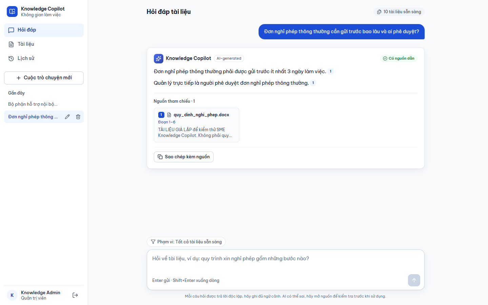
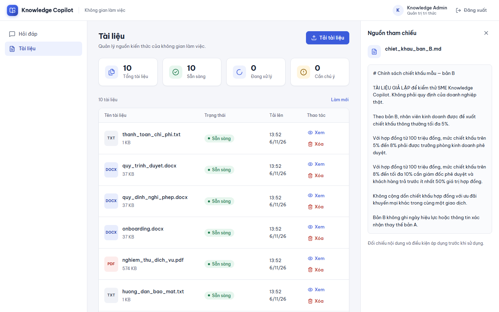
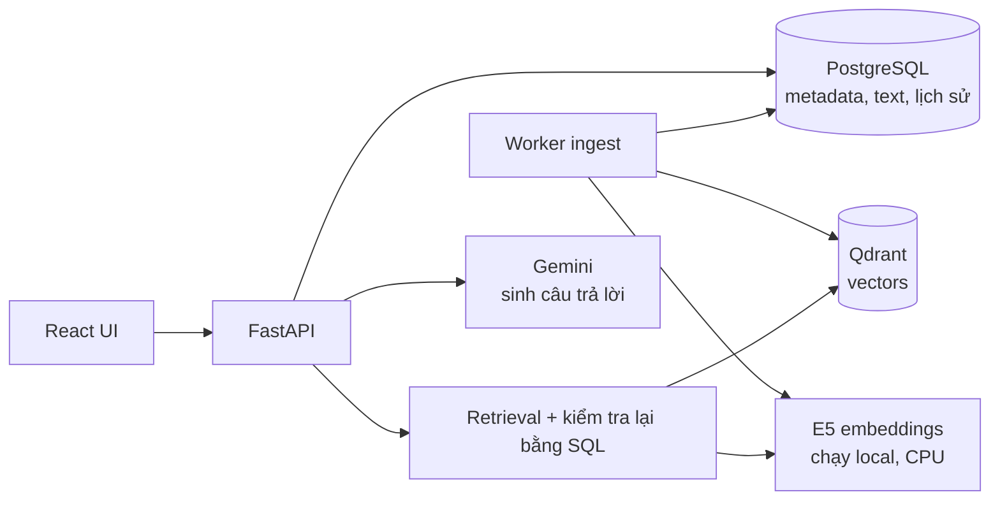

# SME Knowledge Copilot

Trợ lý hỏi đáp tài liệu nội bộ tiếng Việt cho doanh nghiệp nhỏ, xây bằng **Retrieval-Augmented Generation (RAG)**. Mỗi câu trả lời kèm trích dẫn để mở ra đúng đoạn trong tài liệu gốc. Khi tài liệu không có thông tin, hệ thống trả lời **"chưa đủ bằng chứng"** thay vì tự bịa.



## Tính năng

- **Upload tài liệu** PDF (có text), DOCX, TXT, MD. Worker nền đọc, chia đoạn, tạo embedding và lập chỉ mục.
- **Hỏi đáp có trích dẫn.** Câu trả lời được chia thành từng ý, mỗi ý gắn với đoạn nguồn. Bấm vào trích dẫn để xem đúng trang, đoạn hoặc dòng.
- **Ba trạng thái trả lời:** có nguồn dẫn, trả lời một phần (nêu rõ phần còn thiếu hoặc mâu thuẫn), và chưa đủ bằng chứng. Lỗi kỹ thuật được báo là lỗi, không bị giả thành "không có thông tin".
- **Xóa là ngừng dùng ngay.** Tài liệu bị xóa không còn được dùng để trả lời, kể cả trong lịch sử chat, trước khi dữ liệu được dọn hết.
- **Phân quyền:** quản trị viên quản lý tài liệu; thành viên chỉ hỏi đáp; mỗi người chỉ xem được lịch sử chat của mình.



## Cách hoạt động



1. **Ingest:** worker lấy job từ PostgreSQL, parse tài liệu, giữ vị trí nguồn (trang/đoạn/dòng), tạo embedding bằng `multilingual-e5-small` rồi ghi vào Qdrant. Tài liệu chỉ chuyển sang `ready` khi đủ mọi chunk. Worker có lease, retry và tự phục hồi nếu bị dừng giữa chừng.
2. **Truy xuất:** tìm các đoạn gần nhất trong Qdrant, sau đó **kiểm tra lại bằng SQL** (đúng workspace, tài liệu còn `ready`, đúng phiên bản chỉ mục). Không tin dữ liệu trong vector store một mình.
3. **Trả lời:** gửi các đoạn đã chọn cho Gemini và yêu cầu trả về JSON gồm từng ý kèm ID bằng chứng. Backend kiểm tra JSON và ID; sai thì sửa tối đa một lần, vẫn sai thì báo lỗi. Tên file, vị trí và đoạn trích trong trích dẫn do backend dựng, không lấy từ model.

**Công nghệ:** FastAPI, SQLAlchemy/Alembic, PostgreSQL, Qdrant, Hugging Face Transformers (E5 trên CPU), Gemini API (free tier), React + TypeScript + Vite + Tailwind.

## Kết quả đánh giá

Đo trên bộ dữ liệu tự xây: **10 tài liệu nội bộ giả lập** (chính sách nghỉ phép, chiết khấu, bảo mật, nghiệm thu…) và 45 câu hỏi đã được người duyệt, chia tập dev 15 câu và tập held-out 30 câu. Tập held-out chỉ chạy một lần sau khi đã khóa cấu hình; hai người chấm từng câu trả lời.

| Chỉ số (held-out, 30 câu) | Kết quả |
|---|---|
| Thành công đầu-cuối (trả lời đúng / tổng số câu) | **29/30** (≈96,7%). Câu còn lại lỗi HTTP 503 từ Gemini, vẫn tính vào mẫu số |
| Ý trả lời được tài liệu hỗ trợ | 34/34 |
| Trích dẫn đúng | 36/36 |
| Từ chối đúng các câu không có đáp án | 4/4, không từ chối nhầm câu có đáp án (0/25) |
| Retrieval Recall@5 / MRR@5 (26 câu có đáp án) | 1,0 / 0,98 |
| Thời gian trả lời p50 / p95 (một request mỗi lúc) | ≈ 39 s / 45 s, gồm cả thời gian chờ giãn request cho free tier |

Kiểm thử phần mềm: **302 test backend** (trên PostgreSQL và Qdrant thật), **277 test eval tooling** và **36 test frontend**, đạt trên một bản clone sạch. 23/23 kịch bản nghiệm thu của spec đạt theo phạm vi bằng chứng đã ghi.

Bộ dữ liệu nhỏ và là dữ liệu giả lập, nên các con số trên **không** phải độ chính xác trên tài liệu doanh nghiệp thật. Chi tiết và dữ liệu gốc: [báo cáo held-out](docs/human-review-heldout-20261112.md), [nghiệm thu](docs/final-acceptance-20261112.md), [cài sạch](docs/fresh-setup-20261112.md), [bằng chứng](eval/reports/final-20261112/).

## Chạy trên máy

Yêu cầu: Windows 10/11 x64, Python 3.12, Node.js 24, Docker Desktop. API, worker và frontend chạy trên máy; Docker chỉ chạy PostgreSQL và Qdrant.

**1. Cài đặt** (từ thư mục repo):

```powershell
py -3.12 -m venv backend\.venv
.\backend\.venv\Scripts\python.exe -m pip install -r backend/requirements-dev.lock -r backend/requirements-worker-cpu.lock -e "./backend[dev,worker]"
cd frontend; npm.cmd ci; cd ..
copy .env.example .env
```

Sửa `.env`: đặt `HF_HOME` / `PIP_CACHE_DIR` / `NPM_CONFIG_CACHE` thành đường dẫn tuyệt đối, và đặt mật khẩu cho `DEMO_ADMIN_PASSWORD` / `DEMO_MEMBER_PASSWORD`.

**2. Tải model E5 một lần** (khoảng 470MB, đúng revision đã khóa). Lệnh ở [runbook](docs/workspace-restoration-20261105.md). Khi chạy, ứng dụng không tự tải model.

**3. Khởi tạo dữ liệu:**

```powershell
docker compose up -d --wait db qdrant
cd backend
.\.venv\Scripts\python.exe -m alembic upgrade head
.\.venv\Scripts\python.exe -m app.seed
cd ..
```

**4. Chạy:** bấm đúp `start-web.cmd`, hoặc chạy `.\start-web.cmd -NoAI` nếu không dùng Gemini. Mở http://127.0.0.1:5173, đăng nhập bằng `demo.admin` hoặc `demo.member` với mật khẩu trong `.env`. Dừng bằng `stop-web.cmd`.

Để sinh câu trả lời, điền `LLM_API_KEY` (Gemini) trong `.env`, rồi đặt `LLM_FREE_TIER_CONFIRMED=true` và `LLM_QUOTA_CONFIRMED=true` sau khi đã kiểm tra project dùng free tier ([hướng dẫn](docs/gemini-free-tier-setup.md)). Hai cờ này là xác nhận thủ công, không phải giới hạn chi phí phía Google.

**Chạy test:**

```powershell
cd backend; .\.venv\Scripts\python.exe -m pytest -q    # cần TEST_DATABASE_URL trỏ tới DB riêng, tên kết thúc bằng _test
cd ..; $env:PYTHONPATH='backend'; .\backend\.venv\Scripts\python.exe -m pytest eval/tests -q    # test SQL cần backend trong PYTHONPATH
cd frontend; npm.cmd run test
```

## Giới hạn

- Chưa đọc được PDF scan (chưa có OCR) và bảng hoặc bố cục phức tạp.
- Mỗi câu hỏi được trả lời độc lập; hệ thống chưa hiểu câu hỏi nối tiếp theo ngữ cảnh.
- Chỉ dùng dense retrieval; chưa có hybrid search hay reranker.
- Worker và API chỉ được kiểm chứng trên Windows; chưa có Docker image chạy được RAG trên Linux.
- Một workspace demo, đăng nhập bằng tài khoản seed; chưa có SSO hay multi-tenant thật.
- Đăng xuất chỉ xóa token ở trình duyệt; backend chưa có endpoint thu hồi token, nên token cũ còn hiệu lực tới khi hết hạn (1 giờ).
- Trích dẫn đúng ID chưa đảm bảo ý trả lời đúng nghĩa; RAG giảm nhưng không loại bỏ hoàn toàn việc model trả lời sai.

## Hướng phát triển

- Hybrid search (BM25 + dense) và reranker, đo trước/sau trên cùng bộ dữ liệu.
- Hỏi nối tiếp có retrieval lại theo ngữ cảnh.
- Cập nhật phiên bản tài liệu và reindex không gián đoạn.
- Docker image Linux cho API và worker.
- Bộ dữ liệu lớn hơn, dùng tài liệu thật được phép.

## Tài liệu thêm

- [Spec RAG v2.1](SME_Knowledge_Copilot_RAG_Specification.md): yêu cầu, bất biến nghiệp vụ, tiêu chí nghiệm thu.
- [PLAN](PLAN.md): kế hoạch và tiến độ từng bước.
- [KNOWLEDGE](KNOWLEDGE.md): lý do các lựa chọn kỹ thuật và đánh đổi.
- Báo cáo từng bước trong [docs/](docs/), dữ liệu đánh giá trong [eval/](eval/).
