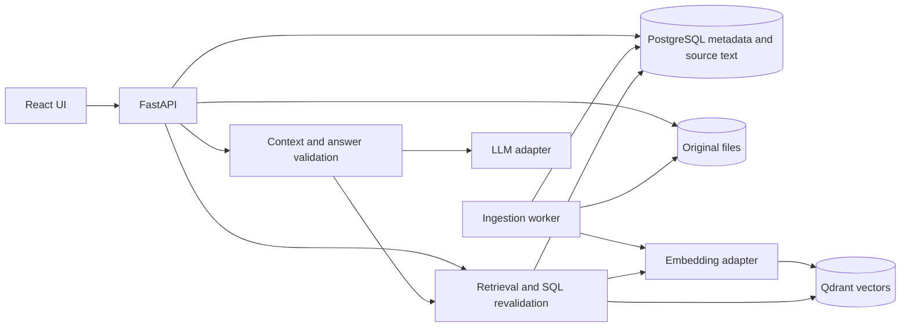

# SME Knowledge Copilot

Project portfolio AI Engineering của nhóm 2 người, xây ứng dụng tìm kiếm và hỏi đáp tài liệu nội bộ tiếng Việt bằng **Retrieval-Augmented Generation (RAG)**, với nguồn dẫn có thể mở kiểm tra.

> **Cập nhật 04/11/2026 — tiến độ 75,6% / 100%:** Bước 00–09 hoàn thành theo phạm vi. Delete SQL disable/redaction, cleanup có lease/retry, source-checked history/replay và late-write reconciliation đã có; **302 backend +91 eval tests đạt**, Ruff 114 files/pip check đạt. Chưa UI/browser E2E hoặc final human-quality/held-out benchmark. Bước 09 không model calls/downloads/paid fallback/commit/push. E5/index/cutoff None và reports Bước 08 giữ nguyên; human review vẫn pending.<br>

**Máy nhận 05/11/2026 đã khôi phục:** 302 backend +91 eval tests, frontend lint/build, Ruff/pip check, E5 local và auth/worker probes đạt. Cache chuyển sang ổ C; hướng dẫn và giới hạn ở [runbook khôi phục](docs/workspace-restoration-20261105.md). Không gọi Gemini; tiến độ sản phẩm giữ 75,6% /100%.

**UI cập nhật 05/11/2026 — 83,4% /100%:** Login, Documents, Knowledge Chat và Source Preview đã nối API;30frontend tests/build/lint đạt. Bước10 ghi nhận4/6, còn browser E2E/visual-keyboard QA; chưa AT-R23/human acceptance. [Report và cách chạy UI](docs/ui-step10-implementation.md). Phiên kiểm thử local không bật Gemini.

- Contract: [Spec RAG v2.1](SME_Knowledge_Copilot_RAG_Specification.md).
- Trình tự thực hiện: [PLAN.md](PLAN.md); [audit chuyển tiếp và backlog P0](docs/rag-transition-audit.md).
- Máy nhận bàn giao và setup hiện tại: [khôi phục workspace 05/11/2026](docs/workspace-restoration-20261105.md).
- Môi trường, commands và resource snapshot lịch sử: [Bước 01](docs/environment-step01.md).
- Dataset và hướng dẫn duyệt: [Bước 02](docs/dataset-step02.md), [dataset README](eval/datasets/README.md).
- Model smoke thật và chuẩn bị Gemini: [Bước 03](docs/model-smoke-step03.md), [hướng dẫn key/free tier](docs/gemini-free-tier-setup.md).
- Schema, tài khoản demo và auth/resource contracts: [Bước 04](docs/schema-identity-step04.md).
- Upload/parser/chunker và gold mapping: [Bước 05](docs/parsing-upload-step05.md). Trước khi code UI sẽ nhắc và chờ xác nhận riêng.
- Worker/E5/Qdrant/publish/recovery và số đo 1+10 documents: [Bước 06](docs/worker-index-step06.md). Chạy host từ backend/: `python -B -m app.worker`, CPU locks dành Windows.
- Search/source APIs, dev retrieval metrics và lựa chọn baseline/cutoff: [Bước 07](docs/search-retrieval-step07.md).
- Context/answering/citations/session, smoke thật và lỗi dự toán quota đã xử lý: [Bước 08](docs/answering-step08.md).
- Delete/privacy/cleanup, retry/recovery và fault/race tests: [Bước 09](docs/deletion-privacy-step09.md), [ADR RAG-08](docs/decisions/0008-document-deletion-and-retention.md).
- Giải thích kiến thức/lựa chọn: [KNOWLEDGE.md](KNOWLEDGE.md).
- Quy tắc workspace: [AGENTS.md](AGENTS.md), [CLAUDE.md](CLAUDE.md). Mọi đợt thay đổi cần người dùng xác nhận **“Thực hiện đi”** trước khi thực hiện.

Spec Operations cũ giữ làm tài liệu lịch sử. Audio/STT, agent và proposal/approval/task nằm ngoài hướng sản phẩm RAG này.

## Kiến trúc

Sơ đồ dưới là **kiến trúc đích**, chưa phải hệ thống đã chạy:



Modular monolith, worker riêng có lease/retry và generation. PostgreSQL quyết định lifecycle/quyền; Qdrant trả vector candidates. Chỉ nguồn ready/active/đúng scope được gửi LLM; citations dựng từ metadata backend. Xóa chặn retrieval trước cleanup.

E5-small CPU và Gemini 3.5 Flash-Lite đã chạy smoke thật; chọn làm cấu hình tạm để xây pipeline. Model/config cuối cùng phải được chọn qua dev benchmark. Dense retrieval là baseline; hybrid/reranker thuộc P1. Chưa có kết quả để khẳng định model thắng.

## Trạng thái kiểm tra nền

Ngày 02/11/2026, sau khôi phục môi trường Bước 01:

| Kiểm tra | Kết quả |
|---|---|
| Ruff lint | PASS — All checks passed, Ruff 0.17.3 |
| Ruff format check | PASS — app/tests/scripts đã kiểm tra với config backend |
| Pytest | **64 passed, 1 warning** — 56 guard cases và 8 legacy tests, PostgreSQL thật |
| Frontend lint/build | **PASS** — TypeScript + Vite production build, 44 modules |
| pip check | PASS — No broken requirements found |
| Docker Compose | db và qdrant running healthy, image digests cố định |
| Storage probes | PostgreSQL 16.15 SELECT 1 thành công; Qdrant 1.20.0 /readyz thành công |

Đây là software/infra baseline, không phải nghiệm thu RAG hoặc benchmark AI. [Báo cáo Bước 01](docs/environment-step01.md) ghi commands, một deprecation warning backend và lần build cần chạy ngoài sandbox. [Baseline Bước 00](docs/rag-transition-audit.md#5-baseline-thực-chạy-ngày-02112026) giữ các lỗi môi trường trước khi khôi phục.

## Chạy trên máy local

### Bấm đúp để mở web trên Windows

Với workspace đã setup trên máy hiện tại, bấm đúp [start-web.cmd](start-web.cmd). Script kiểm tra môi trường, bật Docker Desktop nếu cần, giữ PostgreSQL/Qdrant chạy và mở API, worker, frontend trên host. Khi sẵn sàng, trình duyệt mặc định mở **http://127.0.0.1:5173/**. Đăng nhập bằng `demo.admin` hoặc `demo.member`; mật khẩu tương ứng nằm riêng trong `.env` (`DEMO_ADMIN_PASSWORD` / `DEMO_MEMBER_PASSWORD`).

- `start-web.cmd` mặc định đọc cấu hình Gemini từ `.env`, kiểm tra endpoint/model/key và hai xác nhận free tier/quota trước khi bật web. Thiếu cấu hình sẽ báo tên biến cần xử lý, không in key. Kiểm tra này không gọi model và không xác minh key/quota với Google.
- Bấm lại sẽ dùng phiên đang hoạt động nếu chế độ và `.env` vẫn như cũ. Nếu chuyển chế độ hoặc sửa `.env`, launcher dừng phiên cũ do nó sở hữu rồi kiểm tra và khởi động phiên mới. Cấu hình mới không hợp lệ thì web chưa bật lại; sửa các biến được báo hoặc chạy `-NoAI`. Nếu cổng `8000`/`5173` thuộc ứng dụng khác, script báo lỗi để bạn xử lý.
- Bấm đúp [stop-web.cmd](stop-web.cmd) để dừng API/worker/frontend do launcher mở. PostgreSQL, Qdrant, volumes và tài liệu vẫn được giữ; tránh dừng khi đang upload/xử lý tài liệu.
- Dùng `start-web.cmd -NoAI` khi chỉ kiểm thử local: Gemini bị chặn dù `.env` có key; vẫn xem/upload tài liệu và dùng embedding local, nhưng không sinh câu trả lời. Launcher không sửa `.env`, không tự bật hai cờ xác nhận và không có paid fallback.
- Log nằm ở `.cache/web-dev/launcher.log` và thư mục phiên bên cạnh. Nếu có lỗi, cửa sổ CMD giữ lại thông báo; script không tự cài dependencies, tải model/image, migrate hoặc seed dữ liệu.
- Cần Python venv backend, frontend `node_modules`, cache E5 đã chuẩn bị, Node.js/Docker trên PATH và `.env` hợp lệ. Đây là launcher cho môi trường dev đã setup, không phải bộ cài trên máy mới. Hướng dẫn setup thủ công ở dưới.

Để hỏi đáp bằng AI, cấu hình riêng trong `.env`:

```dotenv
LLM_BASE_URL=https://generativelanguage.googleapis.com/v1beta
LLM_MODEL=gemini-3.5-flash-lite
LLM_API_KEY=<key riêng của bạn>
LLM_FREE_TIER_CONFIRMED=true
LLM_QUOTA_CONFIRMED=true
```

Chỉ đặt hai cờ `true` sau khi bạn đã xác minh project Free, chưa bật billing và còn quota theo [hướng dẫn Gemini](docs/gemini-free-tier-setup.md). Các cờ là xác nhận thủ công, **không phải billing cap của Google**. Launcher bỏ các override `LLM_*` tương ứng kế thừa từ shell để đọc dotenv như backend; nếu có `backend/.env`, file đó có ưu tiên cao hơn `.env` ở root theo Settings hiện tại. Sau khi sửa cấu hình, chạy lại `start-web.cmd` để nạp vào phiên mới.

Chẩn đoán từ PowerShell (các lệnh `Check` không bật/dừng dịch vụ hoặc gọi model):

```powershell
.\start-web.cmd -NoBrowser
.\start-web.cmd -NoAI -NoBrowser
powershell.exe -NoProfile -ExecutionPolicy Bypass -File .\scripts\web-dev.ps1 -Action Check
powershell.exe -NoProfile -ExecutionPolicy Bypass -File .\scripts\web-dev.ps1 -Action Check -NoAI
powershell.exe -NoProfile -File .\scripts\web-dev.ps1 -Action Status
.\stop-web.cmd
```

Wrapper dùng `ExecutionPolicy Bypass` cho **tiến trình PowerShell đó**, không đổi execution policy của máy. API/worker chạy cùng thư mục `backend/`; không chạy thêm worker hoặc tests/eval dùng chung dev queue khi web đang bật. Xem thiết kế ban đầu ở [K-084](KNOWLEDGE.md#k-084--launcher-windows-cho-workspace-dev-đã-setup) và thay đổi chế độ AI ở [K-085](KNOWLEDGE.md#k-085--launcher-đọc-cấu-hình-ai-từ-dotenv-và-nạp-lại-phiên-cũ).

### Setup và chạy thủ công

Backend RAG có API và frontend đã có các màn hình RAG nối API; nghiệm thu browser E2E còn pending. Máy nhận bàn giao ngày 05/11/2026 dùng Python **3.12.1**, Node **24.11.1**, npm **11.6.2** và Docker Desktop. Xem [runbook khôi phục](docs/workspace-restoration-20261105.md) để setup, [report UI](docs/ui-step10-implementation.md) để chạy/kiểm tra giao diện; Bước01 giữ lịch sử Python3.12.8/cacheD. Mỗi đợt cài/chạy có hiệu ứng phụ vẫn cần xác nhận theo AGENTS.

1. Trên checkout mới, tạo venv bằng Python 3.12 rồi cài **cả requirements-dev.lock và requirements-worker-cpu.lock** cùng editable app; frontend dùng npm ci theo package-lock.json. Worker lock dành Windows x64/CPython 3.12. Không tạo đè venv đang dùng; lệnh đầy đủ ở runbook 05/11.
2. .env.example có DB/Qdrant/storage, E5/LLM smoke, auth, parser/chunker/worker/retrieval limits. E5 local đã nối ingestion/search; API host dùng CPU dependencies/cache như worker. .env riêng giữ secrets, không commit/ghi đè credentials. Máy hiện tại đã sinh passwords riêng cho demo.admin/demo.member trong DEMO_ADMIN_PASSWORD/DEMO_MEMBER_PASSWORD. Config .env không tự export biến cache cho shell.
3. Cache máy nhận ở **<repo>/.cache/** (pip/npm/huggingface/tmp), đã được Git ignore. `.env` dùng đường dẫn tuyệt đối trên ổ C; pip/npm cần export biến cache riêng cho shell. E5 phải có đủ sáu files đúng revision đã khóa trước chạy API/worker; runtime không tự tải. Dùng interpreter tường minh và npm.cmd, không cần đổi execution policy.
4. Từ repo root, chạy hai storage và probe:

```powershell
docker compose up -d --wait --wait-timeout 120 db qdrant
.\backend\.venv\Scripts\python.exe -B scripts/check_infra.py
```

5. Sau khi kiểm tra DB target và dữ liệu hiện hữu, từ backend dùng `.\.venv\Scripts\python.exe -B -m alembic upgrade head`, `.\.venv\Scripts\python.exe -B -m app.seed`, rồi `.\.venv\Scripts\python.exe -B -m uvicorn app.main:app --reload`; frontend từ frontend dùng `npm.cmd run dev`. API docs http://localhost:8000/docs, Vite mặc định http://localhost:5173 proxy /api tới backend. Lệnh khởi chạy không có nghĩa API/frontend server được giữ chạy sau khôi phục.

Alembic hiện có `20261103_rag04` sau revision legacy, đã migrate dev/test và seed hai users trên dev. Seed lại từ backend bằng `.\.venv\Scripts\python.exe -B -m app.seed`; mật khẩu lấy riêng từ .env và không tự reset khi seed lại. UI có login và auth guard, không role selector. Compose chưa có worker/frontend service: worker chạy host từ backend/ bằng `.\.venv\Scripts\python.exe -B -m app.worker`, cùng cwd/storage profile với API; không chạy chung DB queue với tests/eval. Xem report UI để biết API phiên kiểm thử đang chặn Gemini bằng process env; không đổi private .env.

## Test và lint

```powershell
# Backend: từ backend/, DB test riêng đã xác minh
.\.venv\Scripts\python.exe -B -m pytest -q -p no:cacheprovider
.\.venv\Scripts\ruff.exe check --no-cache .
.\.venv\Scripts\ruff.exe format --check --no-cache .

# Frontend: từ frontend/, dependencies đã cài
npm.cmd run lint
npm.cmd run build
npm.cmd run test
```

Fixture có guard driver/host/test-name/query, DB test riêng và cleanup workspace/collection. **302 backend +91 eval tests đạt** ở hai suites riêng; cảnh báo Starlette/httpx giữ nguyên. Delete/retry/query/upsert races dùng barriers, PostgreSQL/Qdrant thật và model fakes; không coi đó là semantic accuracy hoặc toàn bộ M1. Windows dùng basetemp mới dưới backend/.cache theo report, không chạy dev worker chung queue test/eval. Các baseline cũ giữ lịch sử.

## Cấu trúc

```text
backend/    FastAPI app, models, migrations (alembic/), tests
frontend/   React + TypeScript UI: auth, documents, chat, source và component tests
eval/       Corpus reviewed, parser mapping, eval scripts/tests và reports lịch sử
docs/       Audit chuyển tiếp và hướng dẫn ADR
```

## Kết quả đánh giá

Dev retrieval đã đo ở Bước07, ingestion1+10 documents ở Bước06; [Bước08](docs/answering-step08.md) có3 oracle +2 API synthetic dev cases thật qua2runs. Run đầu4outputs đạt và1eval_budget_exhausted; retest riêngunknown đạt, giữ lỗi lịch sử. Tổng5generate+25countTokens theo xác nhận riêng,0USD/free tier; chưa answering accuracy/held-out/UI E2E benchmark. Mỗi run lưu manifest/config/source snapshots, outputs/metrics/report dưới eval/reports/<run_id>/. Không dùng literal probes hoặc recall làm accuracy trả lời.

Snapshot [reviewed-v1](eval/snapshots/reviewed-v1/corpus_manifest.json) có **10 tài liệu, 45/45 câu human-approved, 8 fixtures**, hash cả review ledger. **86 eval tests pass** sau Bước 07; canonical mapping đủ45 câu/47 references và dev retrieval benchmark đã có; answering smoke có ở Bước08; human-quality/held-out/UI E2E AT-R22 còn sau. E5 CPU smoke lịch sử đạt35 passages/5 dev queries,384 chiều, peak RSS mẫu~723MiB. Gemini run đầu4/5 outputs hợp lệ, conflict retest riêng1/1 đạt; giữ failure/giới hạn, không gọi đây là5/5 cùng prompt v2 hay RAG accuracy. [Báo cáo Bước 03](docs/model-smoke-step03.md); tiến độ theo [PLAN](PLAN.md#quy-ước-báo-tiến-độ-project).

## Roadmap

- **Bước 00:** hoàn thành đồng bộ tài liệu, schema mapping/backlog và baseline có ghi rõ blockers.
- **Bước 01:** hoàn thành môi trường/dependencies/cache, DB/Qdrant và kiểm tra nền. Ngân sách model người dùng chọn **0 USD/free tier**; key/quota chưa kiểm chứng, chưa gọi model.
- **Bước 02:** hoàn thành human review và reviewed snapshot; remapping đã bổ sung bằng artifact riêng ở Bước 05.
- **Bước 03:** gate bắt buộc đạt với E5 CPU/Gemini thật; BGE tùy điều kiện hoãn, giữ cả failure/retest reports.
- **Bước 04:** schema/migration/seed/auth/scope foundation đạt; tổng tiến độ 24,9%.
- **Bước 05:** upload/parser/chunker và canonical source mapping hoàn thành; tổng tiến độ 36,6%, chưa chạy worker.
- **Bước 06:** worker/lease/generation, E5/Qdrant, publish ready/retry/recovery đã chạy; ingestion thật 1+10 documents và 8 fixtures đạt, tổng tiến độ 46,3%.
- **Bước 07:** search/source endpoints, SQL revalidation/span matcher/dev benchmark đạt; E5 baseline/cutoff None, BGE hoãn, tổng tiến độ 56,1%.
- **Bước08:** context/answering/citations/session và abstention đã có, smoke thật và lỗi quota ledger giữ nguyên; tổng tiến độ65,9%.
- **Bước 09:** delete/privacy/cleanup/recovery và fault/race tests hoàn thành theo phạm vi, tiến độ 75,6%.
- **Bước 10 (UI):** đã triển khai mục1–4,30tests/build/lint/HTTP contracts đạt; còn browser E2E và visual-keyboard QA mục5–6. Tiến độ83,4%; chưa đóng gate.
- **P0/M1 — hướng tới 15/11/2026:** auth → upload/index → dense search → Q&A có nguồn → source preview → delete/cleanup; evaluation baseline và E2E.
- **P1/M2:** reindex/update revision, hybrid/reranker, follow-up/metadata nâng cao, inspector/eval UI; triển khai khi baseline đủ ổn định.

## Known limitations

- Backend ingestion/search/answering/citation/session/delete/cleanup và UI nối API đã có. Browser E2E/visual-keyboard QA, final human-quality/held-out và packaging chưa hoàn tất; không coi jsdom tests là browser acceptance.
- PostgreSQL/Qdrant local đã dùng thật ở Bước 06; API smoke dùng TestClient/PostgreSQL test/Qdrant collection riêng, cleanup đúng scope. Worker host Windows; Linux worker image/concurrency stress chưa kiểm chứng. Không giữ API/frontend server chạy thường trực.
- Parser đã kiểm tra text-based PDF/DOCX/TXT/MD và bảng đơn giản; OCR/bảng/layout phức tạp ngoài P0. Chưa stress tài liệu cực đại hoặc đo throughput production, xem giới hạn Bước 05.
- RAG/citation không loại bỏ hallucination; chất lượng tiếng Việt, latency và tài nguyên phải đo bằng corpus riêng.
- Một workspace demo, chưa có cơ chế production multi-tenant/SSO. Dữ liệu demo giả lập/được phép; secret và tài liệu riêng tư không commit.
- Resource snapshot ổ C/RAM trong Bước 01 là của máy cũ; xem runbook 05/11 cho máy nhận. Cache hiện tại ở ổ C, không di chuyển Docker disk. Budget 0 USD/free tier, hết quota không tự chuyển paid.

## Cập nhật dependencies

backend/requirements.lock giữ runtime pins; backend/requirements-dev.lock include runtime + pin dev/transitive đã kiểm tra, thêm PyMuPDF/python-docx/lxml cho corpus offline Bước 02 (extras `corpus`). Frontend dùng package-lock.json; npm ci dùng cho các lần setup tiếp theo. Khi đổi dependencies, cập nhật manifest/lock trong cùng đợt, kiểm tra phù hợp phạm vi và ghi lý do vào KNOWLEDGE. Không freeze toàn venv chứa dev tools vào runtime Docker lock; không thêm STT/model frameworks chỉ để dựng môi trường.

`backend/requirements-ai-cpu.lock` giữ môi trường model smoke; `backend/requirements-worker-cpu.lock` cho worker local trên **Windows x64/Python 3.12**, pin Torch CPU/Transformers/transitives, không dùng wheel Windows cho Docker Linux. Weights/tokenizer dùng cache tuyệt đối trong .env (máy nhận: <repo>/.cache/huggingface), không Git. E5 runtime dùng chung backend worker và eval shim; native Gemini adapter đã nối answer API từ Bước 08. Lần khôi phục này không gọi Gemini hoặc xác minh quota provider.
