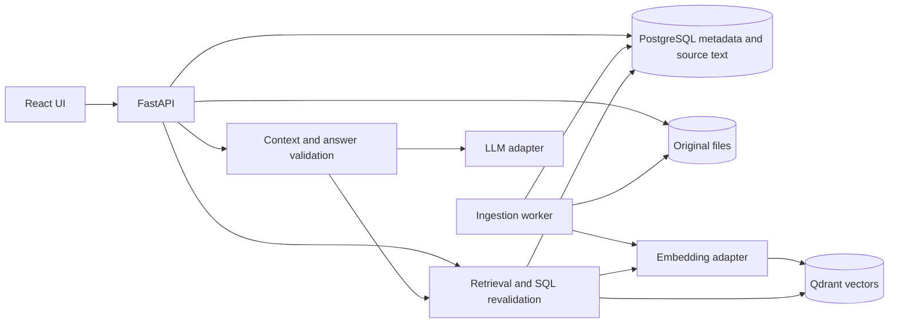

# SME Knowledge Copilot

Project portfolio AI Engineering của nhóm 2 người, xây ứng dụng tìm kiếm và hỏi đáp tài liệu nội bộ tiếng Việt bằng **Retrieval-Augmented Generation (RAG)**, với nguồn dẫn có thể mở kiểm tra.

> **Cập nhật 02/11/2026 — tiến độ 11,2% / 100%:** hoàn thành Bước 00/01; Bước 02 có corpus/câu hỏi nháp và metric tests, còn chờ hai người duyệt nhãn. **Auth, ingestion, worker và hỏi đáp RAG chưa triển khai.** Code app vẫn là skeleton/schema legacy và frontend placeholder.<br>

- Contract: [Spec RAG v2.1](SME_Knowledge_Copilot_RAG_Specification.md).
- Trình tự thực hiện: [PLAN.md](PLAN.md); [audit chuyển tiếp và backlog P0](docs/rag-transition-audit.md).
- Môi trường, commands và resource snapshot: [Bước 01](docs/environment-step01.md).
- Dataset và hướng dẫn duyệt: [Bước 02](docs/dataset-step02.md), [dataset README](eval/datasets/README.md).
- Giải thích kiến thức/lựa chọn: [KNOWLEDGE.md](KNOWLEDGE.md).
- Quy tắc workspace: [AGENTS.md](AGENTS.md), [CLAUDE.md](CLAUDE.md). Mọi đợt thay đổi cần người dùng xác nhận **“Thực hiện đi”** trước khi thực hiện.

Spec Operations cũ giữ làm tài liệu lịch sử. Audio/STT, agent và proposal/approval/task nằm ngoài hướng sản phẩm RAG này.

## Kiến trúc

Sơ đồ dưới là **kiến trúc đích**, chưa phải hệ thống đã chạy:



Modular monolith, worker riêng có lease/retry và generation. PostgreSQL quyết định lifecycle/quyền; Qdrant trả vector candidates. Chỉ nguồn ready/active/đúng scope được gửi LLM; citations dựng từ metadata backend. Xóa chặn retrieval trước cleanup.

PLAN đề xuất smoke E5-small CPU + hosted LLM trên máy hiện tại; model/config cuối cùng phải được chọn qua dev benchmark. Dense retrieval là baseline; hybrid/reranker thuộc P1. Chưa có kết quả để khẳng định model thắng.

## Trạng thái kiểm tra nền

Ngày 02/11/2026, sau khôi phục môi trường Bước 01:

| Kiểm tra | Kết quả |
|---|---|
| Ruff lint | PASS — All checks passed, Ruff 0.17.3 |
| Ruff format check | PASS — app/tests/scripts đã kiểm tra với config backend |
| Pytest | **64 passed, 1 warning** — 56 guard cases và 8 legacy tests, PostgreSQL thật |
| Frontend lint/build | **PASS** — TypeScript + Vite production build, 44 modules |
| pip check | PASS — No broken requirements found |
| Docker Compose | db và qdrant running healthy, image digests cố định |
| Storage probes | PostgreSQL 16.15 SELECT 1 thành công; Qdrant 1.20.0 /readyz thành công |

Đây là software/infra baseline, không phải nghiệm thu RAG hoặc benchmark AI. [Báo cáo Bước 01](docs/environment-step01.md) ghi commands, một deprecation warning backend và lần build cần chạy ngoài sandbox. [Baseline Bước 00](docs/rag-transition-audit.md#5-baseline-thực-chạy-ngày-02112026) giữ các lỗi môi trường trước khi khôi phục.

## Chạy trên máy local

Đây là hướng dẫn chạy skeleton/hạ tầng đã kiểm chứng, chưa phải demo RAG hoàn chỉnh. Baseline máy hiện tại: Python 3.12.8, Node v24.11.1, npm 11.6.2 và Docker Desktop. Mỗi đợt cài/chạy có hiệu ứng phụ vẫn cần xác nhận theo AGENTS.

1. Trên checkout mới, tạo venv bằng Python 3.12 rồi cài từ backend/requirements-dev.lock cùng editable app; frontend dùng npm ci theo package-lock.json. Máy hiện tại đã cài, không cần tạo đè venv. Chi tiết copy-paste nằm trong báo cáo Bước 01.
2. .env.example có config DB/Qdrant/storage, upload 20 MiB và candidate profile E5 CPU; parser/worker/auth/model adapters còn chưa triển khai. .env riêng giữ secrets, không commit/ghi đè credentials. Config trong .env không tự export biến cache cho pip/npm hoặc shell; dùng assignments trong báo cáo.
3. Cache project hiện tại là D:\AI-Cache\sme-copilot (pip/npm/huggingface/tmp). Không tải model trong Bước 01. PowerShell máy này chặn .ps1 nên dùng Python tường minh thay Activate.ps1; không đổi execution policy.
4. Từ repo root, chạy hai storage và probe:

```powershell
docker compose up -d --wait --wait-timeout 120 db qdrant
.\backend\.venv\Scripts\python.exe -B scripts/check_infra.py
```

5. Khi muốn chạy skeleton API, từ backend dùng `.\.venv\Scripts\python.exe -m alembic upgrade head` rồi `.\.venv\Scripts\python.exe -m uvicorn app.main:app --reload`; frontend từ frontend dùng `npm.cmd run dev`. API docs http://localhost:8000/docs, Vite mặc định http://localhost:5173 proxy /api tới backend. Đây là hướng dẫn chạy dev, không phải API/frontend server được giữ chạy sau Bước 01.

Alembic hiện chỉ tạo schema Operations revision 27b126c3c0bc; chưa có bảng RAG. Bước 01 chỉ tạo/migrate DB test riêng, không migrate DB dev. Compose có db/qdrant/backend scaffold; chưa có worker/frontend service. Dockerfile còn startup migration cũ, sẽ tách ở bước đóng gói; dùng lệnh chỉ định db/qdrant để không tự build/start API ngoài nhu cầu.

## Test và lint

```powershell
# Backend: từ backend/, DB test riêng đã xác minh
.\.venv\Scripts\python.exe -B -m pytest -q -p no:cacheprovider
.\.venv\Scripts\ruff.exe check --no-cache .
.\.venv\Scripts\ruff.exe format --check --no-cache .

# Frontend: từ frontend/, dependencies đã cài
npm.cmd run lint
npm.cmd run build
```

Fixture có guard driver/host/test-name/query và chặn tên DB trùng dev trước tạo/migrate; vẫn xác minh môi trường test riêng trước chạy. Dữ liệu mỗi DB test rollback. Tổng baseline 64 gồm 56 guard cases và 8 legacy tests; AT-R01–23 là acceptance RAG cần bổ sung, AT-R24–26 thuộc M2. Chưa có acceptance RAG pass được báo cáo.

## Cấu trúc

```text
backend/    FastAPI app, models, migrations (alembic/), tests
frontend/   React + TypeScript SPA skeleton
eval/       Hướng dẫn đánh giá RAG; dataset/scripts/reports còn cần tạo
docs/       Audit chuyển tiếp và hướng dẫn ADR
```

## Kết quả đánh giá

Chưa có benchmark model/retrieval/answer. Theo [eval/README.md](eval/README.md), mỗi run đích lưu manifest/config, per-question outputs, metrics và report dưới eval/reports/<run_id>/. Đo Hit/Recall/MRR, correctness/citations, abstention, latency và errors theo spec 14; ghi số liệu sau khi thực chạy, không dùng số minh họa trong spec làm thành tích.

Bước 02 có **10 tài liệu giả lập, 45 câu nháp, 8 fixtures**, manifest và metric primitives; **37 eval tests pass** trong lượt riêng với baseline backend 64 cases. **0/45 human-approved**; cần hai người gán/kiểm tra chéo theo [hướng dẫn](eval/datasets/README.md). Các tests này kiểm tra dữ liệu/toán metric, chưa chứng minh model quality hay AT-R21/22 hoàn chỉnh. Tiến độ tính theo trọng số tại [PLAN](PLAN.md#quy-ước-báo-tiến-độ-project).

## Roadmap

- **Bước 00:** hoàn thành đồng bộ tài liệu, schema mapping/backlog và baseline có ghi rõ blockers.
- **Bước 01:** hoàn thành môi trường/dependencies/cache, DB/Qdrant và kiểm tra nền. Ngân sách model người dùng chọn **0 USD/free tier**; key/quota chưa kiểm chứng, chưa gọi model.
- **Bước 02:** có artifacts kỹ thuật và 37 tests đạt; còn chờ hai người duyệt 45 câu, chưa có human gold.
- **Bước kế tiếp — 03:** smoke embedding/LLM sau xác nhận riêng, kiểm tra RAM/đĩa/quota và giữ ngân sách 0 USD; chưa thực hiện.
- **P0/M1 — hướng tới 15/11/2026:** auth → upload/index → dense search → Q&A có nguồn → source preview → delete/cleanup; evaluation baseline và E2E.
- **P1/M2:** reindex/update revision, hybrid/reranker, follow-up/metadata nâng cao, inspector/eval UI; triển khai khi baseline đủ ổn định.

## Known limitations

- Các chức năng RAG và seed auth chưa triển khai; UI hiện còn navigation/placeholder Operations.
- Baseline kiểm tra scaffold/schema legacy, không chứng minh chức năng RAG; PostgreSQL/Qdrant đang chạy local, API/worker/frontend dev servers chưa được giữ chạy.
- Mục tiêu parsing chỉ text-based PDF/DOCX/TXT/MD; OCR, bảng/layout phức tạp ngoài P0. Đây là giới hạn thiết kế, chưa có parser mới để đo.
- RAG/citation không loại bỏ hallucination; chất lượng tiếng Việt, latency và tài nguyên phải đo bằng corpus riêng.
- Một workspace demo, chưa có cơ chế production multi-tenant/SSO. Dữ liệu demo giả lập/được phép; secret và tài liệu riêng tư không commit.
- C free khoảng 10,96 GiB, host free RAM ~3,2 GiB ở snapshot cuối bước; chưa bảo đảm load model lớn. Cache D không di chuyển Docker disk. Budget 0 USD/free tier, hết quota không tự chuyển paid.

## Cập nhật dependencies

backend/requirements.lock giữ runtime pins; backend/requirements-dev.lock include runtime + pin dev/transitive đã kiểm tra, thêm PyMuPDF/python-docx/lxml cho corpus offline Bước 02 (extras `corpus`). Frontend dùng package-lock.json; npm ci dùng cho các lần setup tiếp theo. Khi đổi dependencies, cập nhật manifest/lock trong cùng đợt, kiểm tra phù hợp phạm vi và ghi lý do vào KNOWLEDGE. Không freeze toàn venv chứa dev tools vào runtime Docker lock; không thêm STT/model frameworks chỉ để dựng môi trường.
