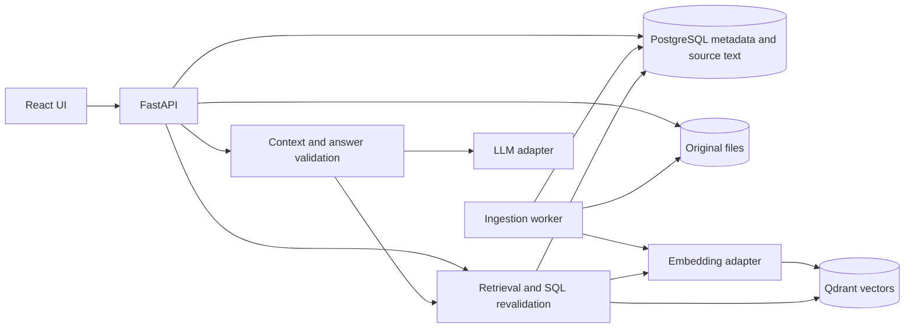

# SME Knowledge Copilot

Project portfolio AI Engineering của nhóm 2 người, xây ứng dụng tìm kiếm và hỏi đáp tài liệu nội bộ tiếng Việt bằng **Retrieval-Augmented Generation (RAG)**, với nguồn dẫn có thể mở kiểm tra.

> **Cập nhật 03/11/2026 — tiến độ 56,1% / 100%:** Bước 00–07 hoàn thành theo phạm vi. Ingestion/search/source APIs và dev retrieval benchmark E5 thật đã có; **222 backend + 86 eval tests đạt**. Dev 13 answerable/2 unknown: Recall@5=1/MRR@5≈0,923, 0 technical errors; không phải answering accuracy/held-out result. Chưa answering/delete/UI, không LLM calls/tải model mới/sửa UI ở Bước 07.<br>

- Contract: [Spec RAG v2.1](SME_Knowledge_Copilot_RAG_Specification.md).
- Trình tự thực hiện: [PLAN.md](PLAN.md); [audit chuyển tiếp và backlog P0](docs/rag-transition-audit.md).
- Môi trường, commands và resource snapshot: [Bước 01](docs/environment-step01.md).
- Dataset và hướng dẫn duyệt: [Bước 02](docs/dataset-step02.md), [dataset README](eval/datasets/README.md).
- Model smoke thật và chuẩn bị Gemini: [Bước 03](docs/model-smoke-step03.md), [hướng dẫn key/free tier](docs/gemini-free-tier-setup.md).
- Schema, tài khoản demo và auth/resource contracts: [Bước 04](docs/schema-identity-step04.md).
- Upload/parser/chunker và gold mapping: [Bước 05](docs/parsing-upload-step05.md). Trước khi code UI sẽ nhắc và chờ xác nhận riêng.
- Worker/E5/Qdrant/publish/recovery và số đo 1+10 documents: [Bước 06](docs/worker-index-step06.md). Chạy host từ backend/: `python -B -m app.worker`, CPU locks dành Windows.
- Search/source APIs, dev retrieval metrics và lựa chọn baseline/cutoff: [Bước 07](docs/search-retrieval-step07.md).
- Giải thích kiến thức/lựa chọn: [KNOWLEDGE.md](KNOWLEDGE.md).
- Quy tắc workspace: [AGENTS.md](AGENTS.md), [CLAUDE.md](CLAUDE.md). Mọi đợt thay đổi cần người dùng xác nhận **“Thực hiện đi”** trước khi thực hiện.

Spec Operations cũ giữ làm tài liệu lịch sử. Audio/STT, agent và proposal/approval/task nằm ngoài hướng sản phẩm RAG này.

## Kiến trúc

Sơ đồ dưới là **kiến trúc đích**, chưa phải hệ thống đã chạy:



Modular monolith, worker riêng có lease/retry và generation. PostgreSQL quyết định lifecycle/quyền; Qdrant trả vector candidates. Chỉ nguồn ready/active/đúng scope được gửi LLM; citations dựng từ metadata backend. Xóa chặn retrieval trước cleanup.

E5-small CPU và Gemini 3.5 Flash-Lite đã chạy smoke thật; chọn làm cấu hình tạm để xây pipeline. Model/config cuối cùng phải được chọn qua dev benchmark. Dense retrieval là baseline; hybrid/reranker thuộc P1. Chưa có kết quả để khẳng định model thắng.

## Trạng thái kiểm tra nền

Ngày 02/11/2026, sau khôi phục môi trường Bước 01:

| Kiểm tra | Kết quả |
|---|---|
| Ruff lint | PASS — All checks passed, Ruff 0.17.3 |
| Ruff format check | PASS — app/tests/scripts đã kiểm tra với config backend |
| Pytest | **64 passed, 1 warning** — 56 guard cases và 8 legacy tests, PostgreSQL thật |
| Frontend lint/build | **PASS** — TypeScript + Vite production build, 44 modules |
| pip check | PASS — No broken requirements found |
| Docker Compose | db và qdrant running healthy, image digests cố định |
| Storage probes | PostgreSQL 16.15 SELECT 1 thành công; Qdrant 1.20.0 /readyz thành công |

Đây là software/infra baseline, không phải nghiệm thu RAG hoặc benchmark AI. [Báo cáo Bước 01](docs/environment-step01.md) ghi commands, một deprecation warning backend và lần build cần chạy ngoài sandbox. [Baseline Bước 00](docs/rag-transition-audit.md#5-baseline-thực-chạy-ngày-02112026) giữ các lỗi môi trường trước khi khôi phục.

## Chạy trên máy local

Đây là hướng dẫn chạy skeleton/hạ tầng đã kiểm chứng, chưa phải demo RAG hoàn chỉnh. Baseline máy hiện tại: Python 3.12.8, Node v24.11.1, npm 11.6.2 và Docker Desktop. Mỗi đợt cài/chạy có hiệu ứng phụ vẫn cần xác nhận theo AGENTS.

1. Trên checkout mới, tạo venv bằng Python 3.12 rồi cài từ backend/requirements-dev.lock cùng editable app; frontend dùng npm ci theo package-lock.json. Máy hiện tại đã cài, không cần tạo đè venv. Chi tiết copy-paste nằm trong báo cáo Bước 01.
2. .env.example có DB/Qdrant/storage, E5/LLM smoke, auth, parser/chunker/worker/retrieval limits. E5 local đã nối ingestion/search; API host dùng CPU dependencies/cache như worker. .env riêng giữ secrets, không commit/ghi đè credentials. Máy hiện tại đã sinh passwords riêng cho demo.admin/demo.member trong DEMO_ADMIN_PASSWORD/DEMO_MEMBER_PASSWORD. Config .env không tự export biến cache cho shell.
3. Cache project hiện tại là D:\AI-Cache\sme-copilot (pip/npm/huggingface/tmp). Không tải model trong Bước 01. PowerShell máy này chặn .ps1 nên dùng Python tường minh thay Activate.ps1; không đổi execution policy.
4. Từ repo root, chạy hai storage và probe:

```powershell
docker compose up -d --wait --wait-timeout 120 db qdrant
.\backend\.venv\Scripts\python.exe -B scripts/check_infra.py
```

5. Khi muốn chạy skeleton API, từ backend dùng `.\.venv\Scripts\python.exe -m alembic upgrade head` rồi `.\.venv\Scripts\python.exe -m uvicorn app.main:app --reload`; frontend từ frontend dùng `npm.cmd run dev`. API docs http://localhost:8000/docs, Vite mặc định http://localhost:5173 proxy /api tới backend. Đây là hướng dẫn chạy dev, không phải API/frontend server được giữ chạy sau Bước 01.

Alembic hiện có `20261103_rag04` sau revision legacy, đã migrate dev/test và seed hai users trên dev. Seed lại từ backend bằng `.\.venv\Scripts\python.exe -B -m app.seed`; mật khẩu lấy riêng từ .env và không tự reset khi seed lại. Swagger có login/me/upload/retry khi chạy server; chưa auth UI. Compose chưa có worker/frontend service: worker chạy host từ backend/ bằng `.\.venv\Scripts\python.exe -B -m app.worker`, dùng cùng cwd/storage profile với API. Xem Bước 06 trước khi chạy; không chạy worker chung DB khi tests/smoke đang dùng queue. Bước 06 đã dùng DB/Qdrant thật, CLI --once khởi động đạt.

## Test và lint

```powershell
# Backend: từ backend/, DB test riêng đã xác minh
.\.venv\Scripts\python.exe -B -m pytest -q -p no:cacheprovider
.\.venv\Scripts\ruff.exe check --no-cache .
.\.venv\Scripts\ruff.exe format --check --no-cache .

# Frontend: từ frontend/, dependencies đã cài
npm.cmd run lint
npm.cmd run build
```

Fixture có guard driver/host/test-name/query và chặn tên DB trùng dev trước tạo/migrate; vẫn xác minh DB test riêng trước chạy. Unit/API DB fixtures rollback; worker/concurrency/search tests có transactions thật và cleanup workspace/collection riêng. Trên Windows dùng basetemp mới/đường dẫn ngắn trong .cache theo report Bước 06 khi Temp ACL bị chặn. Hiện **222 backend/86 eval tests đạt** ở hai suites riêng; baseline64 ngày02/11 giữ lịch sử. Worker/search/source/span metrics đã kiểm tra, còn answering/delete/E2E cần các bước sau; không coi đây là toàn bộ AT-R01–23/M1 hoặc AT-R24–26/M2.

## Cấu trúc

```text
backend/    FastAPI app, models, migrations (alembic/), tests
frontend/   React + TypeScript SPA skeleton
eval/       Hướng dẫn đánh giá RAG; dataset/scripts/reports còn cần tạo
docs/       Audit chuyển tiếp và hướng dẫn ADR
```

## Kết quả đánh giá

Dev retrieval đã đo ở Bước 07, ingestion 1+10 documents ở Bước 06; chưa có answering/held-out/E2E benchmark. Theo [eval/README.md](eval/README.md), mỗi run lưu manifest/config, per-question outputs, metrics và report dưới eval/reports/<run_id>/. Hiện có Hit/Recall/MRR/All-evidence/latency/errors cho dev retrieval; correctness/citations/abstention của answering còn bước sau. Không dùng số minh họa trong spec hoặc recall để trình bày thành accuracy trả lời.

Snapshot [reviewed-v1](eval/snapshots/reviewed-v1/corpus_manifest.json) có **10 tài liệu, 45/45 câu human-approved, 8 fixtures**, hash cả review ledger. **86 eval tests pass** sau Bước 07; canonical mapping đủ45 câu/47 references và dev retrieval benchmark đã có; answering/held-out/E2E AT-R22 còn sau. E5 CPU smoke lịch sử đạt35 passages/5 dev queries,384 chiều, peak RSS mẫu~723MiB. Gemini run đầu4/5 outputs hợp lệ, conflict retest riêng1/1 đạt; giữ failure/giới hạn, không gọi đây là5/5 cùng prompt v2 hay RAG accuracy. [Báo cáo Bước 03](docs/model-smoke-step03.md); tiến độ theo [PLAN](PLAN.md#quy-ước-báo-tiến-độ-project).

## Roadmap

- **Bước 00:** hoàn thành đồng bộ tài liệu, schema mapping/backlog và baseline có ghi rõ blockers.
- **Bước 01:** hoàn thành môi trường/dependencies/cache, DB/Qdrant và kiểm tra nền. Ngân sách model người dùng chọn **0 USD/free tier**; key/quota chưa kiểm chứng, chưa gọi model.
- **Bước 02:** hoàn thành human review và reviewed snapshot; remapping đã bổ sung bằng artifact riêng ở Bước 05.
- **Bước 03:** gate bắt buộc đạt với E5 CPU/Gemini thật; BGE tùy điều kiện hoãn, giữ cả failure/retest reports.
- **Bước 04:** schema/migration/seed/auth/scope foundation đạt; tổng tiến độ 24,9%.
- **Bước 05:** upload/parser/chunker và canonical source mapping hoàn thành; tổng tiến độ 36,6%, chưa chạy worker.
- **Bước 06:** worker/lease/generation, E5/Qdrant, publish ready/retry/recovery đã chạy; ingestion thật 1+10 documents và 8 fixtures đạt, tổng tiến độ 46,3%.
- **Bước 07:** search/source endpoints, SQL revalidation/span matcher/dev benchmark đạt; E5 baseline/cutoff None, BGE hoãn, tổng tiến độ 56,1%.
- **Tiếp theo — Bước 08:** context/answering/citations/session và abstention; cần xác nhận riêng, budget 0 USD.
- **P0/M1 — hướng tới 15/11/2026:** auth → upload/index → dense search → Q&A có nguồn → source preview → delete/cleanup; evaluation baseline và E2E.
- **P1/M2:** reindex/update revision, hybrid/reranker, follow-up/metadata nâng cao, inspector/eval UI; triển khai khi baseline đủ ổn định.

## Known limitations

- Auth/metadata/upload/worker/index/retry/search/source APIs đã có; UI vẫn placeholder, chưa login/upload/chat/preview. RAG answering/citations/delete workflow còn thiếu.
- PostgreSQL/Qdrant local đã dùng thật ở Bước 06; API smoke dùng TestClient/PostgreSQL test/Qdrant collection riêng, cleanup đúng scope. Worker host Windows; Linux worker image/concurrency stress chưa kiểm chứng. Không giữ API/frontend server chạy thường trực.
- Parser đã kiểm tra text-based PDF/DOCX/TXT/MD và bảng đơn giản; OCR/bảng/layout phức tạp ngoài P0. Chưa stress tài liệu cực đại hoặc đo throughput production, xem giới hạn Bước 05.
- RAG/citation không loại bỏ hallucination; chất lượng tiếng Việt, latency và tài nguyên phải đo bằng corpus riêng.
- Một workspace demo, chưa có cơ chế production multi-tenant/SSO. Dữ liệu demo giả lập/được phép; secret và tài liệu riêng tư không commit.
- C free khoảng 10,96 GiB, host free RAM ~3,2 GiB ở snapshot cuối bước; chưa bảo đảm load model lớn. Cache D không di chuyển Docker disk. Budget 0 USD/free tier, hết quota không tự chuyển paid.

## Cập nhật dependencies

backend/requirements.lock giữ runtime pins; backend/requirements-dev.lock include runtime + pin dev/transitive đã kiểm tra, thêm PyMuPDF/python-docx/lxml cho corpus offline Bước 02 (extras `corpus`). Frontend dùng package-lock.json; npm ci dùng cho các lần setup tiếp theo. Khi đổi dependencies, cập nhật manifest/lock trong cùng đợt, kiểm tra phù hợp phạm vi và ghi lý do vào KNOWLEDGE. Không freeze toàn venv chứa dev tools vào runtime Docker lock; không thêm STT/model frameworks chỉ để dựng môi trường.

`backend/requirements-ai-cpu.lock` giữ môi trường model smoke; `backend/requirements-worker-cpu.lock` cho worker local trên **Windows x64/Python 3.12**, pin Torch CPU/Transformers/transitives, không dùng wheel Windows cho Docker Linux. Weights/tokenizer cache D, không Git. E5 runtime đã dùng chung backend worker và eval shim; Gemini vẫn là smoke adapter, chưa nối answer API.
