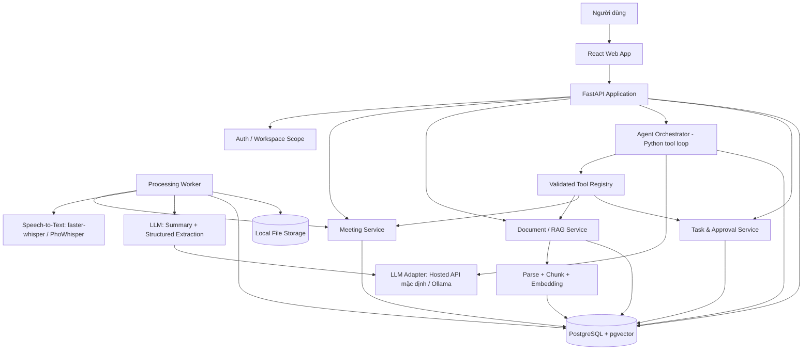
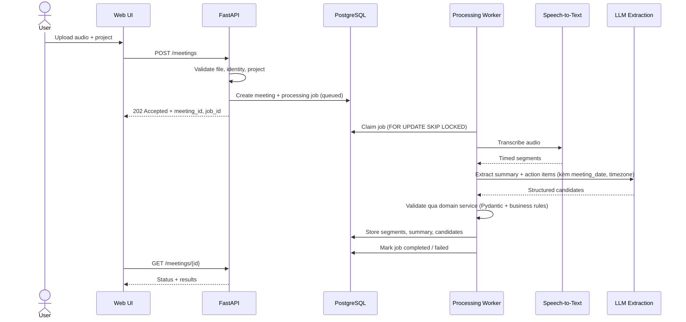
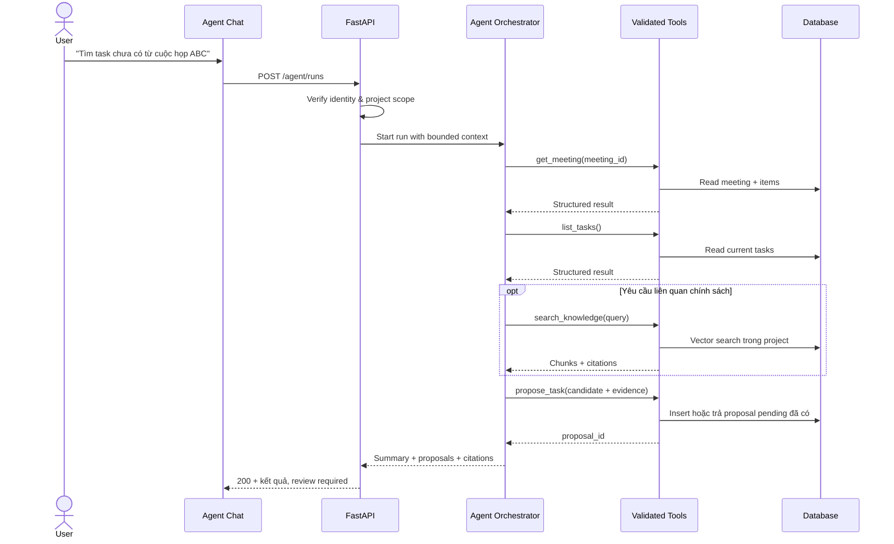
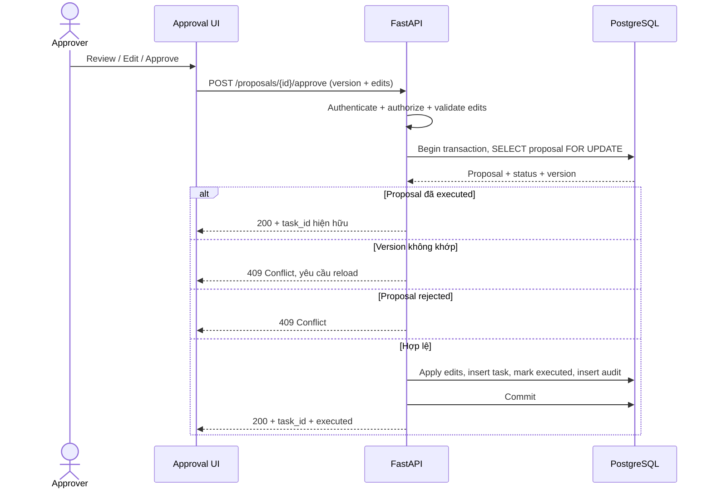
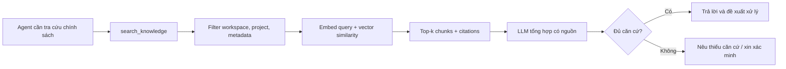
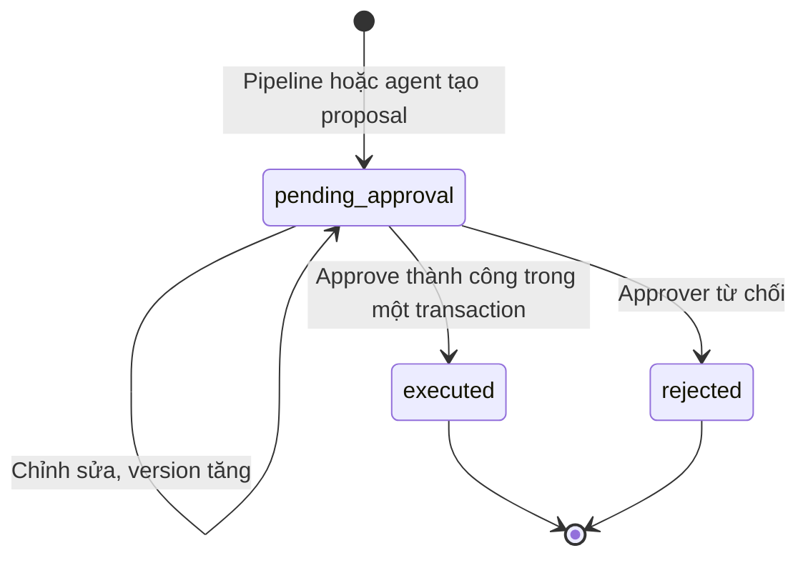

# SME AI Operations Copilot

> **Software Requirements & Technical Specification (SRS + Technical Design)**  
> **Phiên bản:** 1.1 — bản đề xuất để triển khai, chưa phải tài liệu nghiệm thu  
> **Cập nhật:** 29/10/2026 (xem thay đổi so với v1.0 ở [Phụ lục A](#phụ-lục-a--thay-đổi-so-với-v10))  
> **Loại dự án:** Portfolio / AI Engineering learning project  
> **Nhân sự phát triển:** 02 thành viên, sử dụng Claude làm coding assistant  
> **Mốc M1 — 15/11/2026 (hạn nộp CV):** luồng cốt lõi chạy end-to-end, repo và README ở trạng thái trình bày được  
> **Mốc M2 — sau 15/11/2026:** agent, RAG, đánh giá đầy đủ; phục vụ các vòng phỏng vấn  
> **Định hướng:** phục vụ việc học AI Engineering, bổ sung CV và ứng tuyển VNG AI Builder Residency

---

## 1. Tóm tắt sản phẩm

**SME AI Operations Copilot** là ứng dụng web hỗ trợ doanh nghiệp dịch vụ quy mô nhỏ/vừa biến **nội dung cuộc họp và tài liệu nội bộ thành công việc có thể kiểm tra, phê duyệt và theo dõi**. Hệ thống kết hợp:

1. **Meeting Intelligence:** tiếp nhận file âm thanh, chuyển giọng nói thành văn bản, tóm tắt cuộc họp và trích xuất *action items*.
2. **Enterprise Knowledge / RAG:** nhập các tài liệu nghiệp vụ và tìm đoạn thông tin liên quan kèm nguồn dẫn.
3. **AI Agent & Tool Calling:** hiểu yêu cầu bằng ngôn ngữ tự nhiên, lựa chọn công cụ để tra cứu cuộc họp, tài liệu và task; đề xuất hành động dựa trên kết quả.
4. **Human-in-the-loop Workflow:** người dùng xem xét/sửa/từ chối hoặc chấp thuận các đề xuất trước khi hệ thống ghi task chính thức.
5. **Task & Audit Management:** quản lý task và lưu lịch sử các thao tác quan trọng.

**Định vị kỹ thuật:** *AI-assisted workflow automation*, không phải chatbot hỏi đáp đơn thuần và cũng không phải hệ thống tự động ra quyết định thay con người.

**Điểm nhấn riêng:** dữ liệu mục tiêu là **cuộc họp tiếng Việt có xen thuật ngữ tiếng Anh** ("deadline", "push code", "fix bug"…). Dự án đo và báo cáo chất lượng STT/extraction trên loại dữ liệu này thay vì giả định model đa ngôn ngữ hoạt động tốt.

### 1.1. Câu chuyện sản phẩm (product narrative)

Một quản lý dự án trong SME thường có nhiều cuộc họp với khách hàng. Sau mỗi cuộc họp, các đầu việc nằm rải rác trong bản ghi âm, chat và tài liệu. Quản lý muốn hỏi:

> "Xem cuộc họp dự án ABC, đối chiếu với danh sách công việc hiện tại, đề xuất các task còn thiếu và kiểm tra xem yêu cầu giảm giá có vi phạm chính sách không."

Hệ thống phải có khả năng: lấy thông tin từ cuộc họp → tìm tasks đang có → tìm tài liệu chính sách khi yêu cầu cần → tổng hợp bằng chứng → tạo **đề xuất** → chờ người có quyền xác nhận → ghi vào hệ thống quản lý task và báo cáo kết quả.

Tình huống kiểm tra chính sách là lý do chính để dùng agent thay vì pipeline cố định: agent phải **tự quyết định có cần tra cứu tài liệu hay không**. Vì vậy đối chiếu chính sách qua RAG thuộc P0 (mốc M2), không phải P1.

### 1.2. Mục tiêu

| Mã | Mục tiêu | Cách thể hiện |
|---|---|---|
| G-01 | Giải quyết một workflow SME có ý nghĩa thực tế | Demo xuyên suốt: audio → đề xuất → phê duyệt → task |
| G-02 | Thực hành GenAI/AI Engineering | STT, structured extraction, embeddings, retrieval, tool calling |
| G-03 | Áp dụng SWE vào hệ thống AI | API, DB, state machine, xử lý lỗi, phân quyền, kiểm thử |
| G-04 | Đánh giá thay vì chỉ trình diễn | Có test dataset, metrics và failure cases |
| G-05 | Dễ giải thích trong CV/phỏng vấn | Có kiến trúc, trade-offs, kết quả đo và đóng góp cá nhân rõ ràng |
| G-06 | Đánh giá trên dữ liệu tiếng Việt thực tế | WER và độ chính xác extraction trên hội thoại tiếng Việt có xen tiếng Anh; so sánh ít nhất 2 STT model |

### 1.3. Giới hạn và giả định thiết kế

- **Khách hàng giả định:** một SME dịch vụ/agency có dự án, cuộc họp, nhân viên và bộ tài liệu chính sách. Đây là domain tham chiếu, **không** tuyên bố áp dụng ngay cho mọi SME.
- **Quy mô demo:** một workspace/doanh nghiệp; dữ liệu mẫu hoặc dữ liệu được cho phép sử dụng. Không đặt mục tiêu vận hành sản xuất cho nhiều khách hàng.
- **Xác thực P0:** các tài khoản demo có danh tính và role do backend kiểm tra (seed tài khoản, mật khẩu được hash); không dựa trên role do frontend tự khai báo. Việc đăng ký/đặt lại mật khẩu/SSO thuộc P1 hoặc ngoài phạm vi.
- **Ngôn ngữ chính:** tiếng Việt; các trường dữ liệu/API đặt tên tiếng Anh.
- **Chỉ nhận file cuộc họp đã ghi âm:** không ghi âm hoặc tham dự cuộc họp trực tiếp trong MVP.
- **Không có diarization:** hệ thống không biết ai đang nói. Người phụ trách chỉ được trích xuất khi transcript **nêu tên rõ ràng** (xem 4.2).
- **Một AI Agent với tập tools xác định trước**; không dùng multi-agent, auto-planning không giới hạn hay tác vụ chạy tự chủ ngoài phiên yêu cầu.
- **Thiết kế ưu tiên độ tin cậy:** LLM đưa ra dự đoán/đề xuất, backend giữ quyền thực thi và xác nhận nghiệp vụ.
- **Thời gian và nhân sự là ràng buộc phạm vi**, không phải cam kết về chất lượng hay hiệu năng. Tài liệu này chia phạm vi theo mốc (2.2) nhưng không lập lịch chi tiết hay phân công nhân sự.

---

## 2. Phạm vi sản phẩm

### 2.1. Phạm vi MVP (Must-have / P0)

| Mã | Module | Chức năng bắt buộc | Kết quả mong đợi | Mốc |
|---|---|---|---|---|
| FR-01 | Workspace | Chọn workspace và dự án mẫu | Mọi dữ liệu gắn project/workspace xác định | M1 |
| FR-02 | Document ingestion | Upload PDF, DOCX có text; trích xuất, chia đoạn, tạo embeddings | Tài liệu ở trạng thái `ready` hoặc `failed` rõ ràng | M2 |
| FR-03 | Retrieval | Tìm kiếm tài liệu theo câu hỏi/chủ đề, trả nguồn | Trả các đoạn liên quan, tên file, trang/đoạn | M2 |
| FR-04 | Meeting ingestion | Upload MP3/WAV/M4A, lưu tệp và trạng thái xử lý | Có `meeting_id`, `job_status` | M1 |
| FR-05 | Speech-to-Text | Chuyển audio sang transcript có timestamps mức segment | Xem lại được transcript và đoạn tương ứng | M1 |
| FR-06 | Meeting intelligence | Tóm tắt; trích xuất action items có bằng chứng | Task candidate có title, assignee/deadline nếu rõ | M1 |
| FR-07 | Agent chat | Nhận yêu cầu tự nhiên, gọi tool đọc dữ liệu | Hiển thị câu trả lời và các tool đã sử dụng | M2 |
| FR-08 | Agent task review | Đối chiếu action items với task hiện hữu, tra cứu chính sách khi cần, đề xuất task còn thiếu | Tạo *draft proposals* có bằng chứng, không ghi task chính thức | M2 |
| FR-09 | Approval | Người dùng duyệt/từ chối/chỉnh sửa đề xuất; backend kiểm tra quyền | Chỉ task được duyệt mới được tạo | M1 |
| FR-10 | Task management | Danh sách task với trạng thái, người phụ trách, deadline, nguồn | Xem kết quả thực thi và task được liên kết | M1 |
| FR-11 | History & audit | Lưu tình trạng run, kết quả tool, quyết định duyệt, lỗi | Truy vết được nguồn của task và người duyệt | M1 (ghi DB), M2 (UI xem) |
| FR-12 | Evaluation | Test chức năng và bộ tình huống AI cơ bản | Có số đo/nhận xét, không chỉ demo thành công | M1 (tối thiểu), M2 (đầy đủ) |

**MVP không có nghĩa mỗi module phải đầy đủ tính năng.** Mục tiêu là hoàn thành đúng một luồng end-to-end đáng tin cậy. Ví dụ, module RAG chỉ cần ingestion tài liệu text-based, semantic retrieval và trích dẫn; chưa cần hybrid search/reranking.

### 2.2. Phạm vi theo mốc

**M1 — 15/11/2026 (hạn nộp CV): Baseline A chạy end-to-end.**

| Hạng mục | Nội dung |
|---|---|
| Luồng chính | Upload audio → STT → summary + action items → người dùng tạo proposal từ action item → approver duyệt → task được tạo một lần duy nhất |
| Bảo đảm nghiệp vụ | Test cho NFR-01 (không bypass approval), NFR-02 (approve lặp), NFR-09 (phân quyền), NFR-11 (không trùng proposal) |
| UI | Project, Meetings, Approvals & Tasks |
| Hạ tầng | Seed users có role; Docker Compose tối thiểu cho PostgreSQL + backend |
| Đánh giá | Bộ nhỏ ~5 cuộc họp: WER của 1 STT model, precision/recall action items |
| Trình bày | README có sơ đồ kiến trúc, cách chạy, video demo 2–3 phút, mục *Trạng thái hiện tại / Roadmap* và *Known limitations* |

**M2 — sau 15/11/2026: Approach B và đánh giá đầy đủ.**

| Hạng mục | Nội dung |
|---|---|
| Agent | Python tool loop với `get_meeting`, `list_tasks`, `search_knowledge`, `propose_task`; UI AI Copilot |
| RAG | Ingestion PDF/DOCX, semantic search, citations; tình huống đối chiếu chính sách |
| Đánh giá | So sánh STT (faster-whisper và PhoWhisper); Recall@k; tool selection; so sánh Baseline A và Approach B; failure analysis |
| UI | Knowledge, AI Copilot, xem audit |

**Quy tắc:** nội dung CV và README tại M1 chỉ mô tả những gì đã hoàn thành và đo được tại M1. Phần M2 được ghi là *roadmap/đang phát triển*.

### 2.3. Mở rộng sau MVP (Should-have / P1)

- Tìm kiếm theo ngữ nghĩa trên nhiều cuộc họp và tổng hợp lịch sử quyết định của dự án.
- Lọc chính sách theo phiên bản hiệu lực (`effective_from/to`) và loại tài liệu.
- Tool `list_meetings`, `get_project_members` (gợi ý ánh xạ `assignee_name` → nhân viên; approver vẫn xác nhận).
- Soạn email thông báo/nhắc việc nhưng **không tự gửi**.
- Chỉnh sửa transcript và tái chạy trích xuất action items.
- Nâng cấp xác thực từ tài khoản demo sang cơ chế đăng nhập/đăng ký đầy đủ, quản trị phân quyền theo nhiều dự án và tổ chức.
- Đánh giá retrieval nâng cao, hybrid search, reranking hoặc query rewriting khi baseline chưa đạt.
- Thử nghiệm agent với LLM chạy local (Ollama) và so sánh với LLM hosted.

### 2.4. Ngoài phạm vi (Won't-have trong MVP)

- Bot tham gia Google Meet/Zoom/Teams và ghi âm trực tiếp; realtime speech transcription.
- Tự động gửi email, thanh toán, sửa chính sách, thay đổi hợp đồng hoặc truy cập web tùy ý.
- Tích hợp production với CRM/ERP/Jira/Trello/Slack và hệ thống của doanh nghiệp thật.
- Diarization (xác định chính xác ai nói), nhận dạng giọng nói theo danh tính, dịch đa ngôn ngữ hoàn chỉnh.
- OCR tài liệu scan phức tạp, trích xuất bảng/hình ảnh có độ chính xác cao.
- Multi-tenant production, SSO, hệ thống permission phức tạp, autoscaling/Kubernetes.
- Fine-tuning LLM, xây/training speech model hoặc foundation model từ đầu.
- Agent tự thực thi workflow dài hạn khi không có người giám sát.

---

## 3. Người dùng và use cases

### 3.1. Vai trò

| Vai trò | Quyền nghiệp vụ |
|---|---|
| `member` | Upload tài liệu/audio, xem dữ liệu được phép, hỏi agent, tạo proposal từ action item, xem task và đề xuất |
| `approver` | Có quyền của member; được duyệt/từ chối đề xuất tạo task thuộc phạm vi dự án |
| `demo_admin` | Thiết lập project, tài khoản mẫu và nguồn dữ liệu demo |

Đối với bản trình diễn một người dùng, có thể dùng **demo mode** và một tài khoản có quyền `approver`, nhưng phải ghi rõ đây không phải cơ chế bảo mật production. Không được cho frontend tự khai báo vai trò rồi backend tin ngay.

### 3.2. Use cases chính

| ID | Use case | Actor | Đầu ra | Mốc |
|---|---|---|---|---|
| UC-01 | Nhập tài liệu chính sách | Member | Document indexed, searchable | M2 |
| UC-02 | Upload bản ghi âm cuộc họp | Member | Meeting, transcript, summary, action items | M1 |
| UC-03 | Kiểm tra action items, tạo proposal từ action item | Member | Proposal `pending_approval` (origin `pipeline`) | M1 |
| UC-04 | Hỏi về cuộc họp, tài liệu, task | Member | Câu trả lời có bằng chứng hoặc thông báo không đủ dữ liệu | M2 |
| UC-05 | Yêu cầu agent tạo task còn thiếu | Member | Danh sách task proposals (origin `agent`), không thực thi ngay | M2 |
| UC-06 | Phê duyệt (có thể kèm chỉnh sửa) hoặc từ chối | Approver | Task chính thức hoặc proposal bị từ chối | M1 |
| UC-07 | Xem lịch sử tác vụ và nguồn | Member | Trace tối thiểu và audit events | M1 (dữ liệu), M2 (UI) |

---

## 4. Yêu cầu chức năng chi tiết

### 4.1. Documents & RAG

**Đầu vào:** PDF/DOCX dạng text; metadata `{project_id, title, category, effective_from?, effective_to?}`.  
**Xử lý:** xác minh file → extract text → clean → chunk → embed → lưu chunks và metadata → cho phép semantic search.  
**Đầu ra:** danh sách `DocumentChunk` với `document_id`, tên tài liệu, số trang nếu có, `chunk_text`, điểm tương đồng, khoảng thời gian hiệu lực (nếu đã nhập).

**Quy tắc:**

- Nguồn trống/không parse được phải trả lỗi rõ ràng; không báo `ready` nếu chưa index xong.
- Có cơ chế chống nhập trùng theo checksum hoặc cảnh báo file trùng.
- Mỗi kết quả retrieval phải gắn đúng project/workspace do backend kiểm tra.
- Không xem similarity score là xác suất câu trả lời đúng.
- Nếu không đủ tài liệu, agent báo thiếu căn cứ; không tự tạo điều khoản chính sách.
- Ưu tiên **semantic search** (top-k có cấu hình); hybrid search/reranker là P1.
- Khi đưa nguồn vào context của LLM, coi đó là **dữ liệu không đáng tin tuyệt đối**, không phải chỉ dẫn hệ thống.

**Ghi chú:** RAG hữu ích nhất trong các bước phải tham chiếu tài liệu phi cấu trúc. Dữ liệu task có cấu trúc phải được truy vấn SQL; không bắt buộc đưa mọi bản ghi vào vector DB.

### 4.2. Meeting Intelligence

**Đầu vào:** file audio MP3/WAV/M4A; `project_id`, `meeting_title`, `meeting_date`. Giới hạn file/duration ban đầu là **tham số cấu hình**, ví dụ 25 MB hoặc 30 phút, và phải đo trên máy thực tế trước khi công bố giới hạn cuối cùng.

**Pipeline:** kiểm tra loại file/size → lưu file → tạo job → STT → segment timestamps → summary → structured action extraction → validate qua domain service → lưu DB.  
**Đầu ra:**

- Transcript theo các `segments`: `{start_sec, end_sec, text}`.
- Summary có các nhóm: `overview`, `decisions`, `open_questions`.
- Action item candidate: `title`, `description?`, `assignee_name?`, `due_date?`, `evidence_segment_ids[]`, `confidence_note?`, `needs_review`.

**Quy tắc:**

- `assignee`/`due_date` được để `null` nếu không rõ; không phỏng đoán thông tin còn thiếu.
- **Không có diarization nên không suy ra người nói.** Câu không nêu tên (ví dụ "để em làm cái này", "anh lo phần đó nhé") → `assignee_name = null`, `needs_review = true`. Chỉ điền `assignee_name` khi transcript nêu tên rõ ("Minh phụ trách phần thiết kế").
- **Ngày tương đối:** prompt extraction phải nhận `meeting_date` và timezone (`Asia/Ho_Chi_Minh`) để giải các cụm như "thứ Hai tới", "cuối tuần này". Nếu không xác định được ngày cụ thể, để `due_date = null`.
- **Code-switching:** transcript có thể chứa thuật ngữ tiếng Anh hoặc từ bị STT nhận sai; prompt extraction không được "sửa" nội dung thành thông tin mới.
- Văn bản STT có thể sai; UI phải hiển thị đây là kết quả AI tạo ra.
- Mỗi task candidate phải liên kết với ít nhất một segment làm bằng chứng (nếu việc trích xuất có đủ căn cứ); nếu thiếu bằng chứng, đánh dấu `needs_review` và không đề xuất tạo tự động.
- Dữ liệu audio phải có sự đồng ý của người liên quan; dùng dữ liệu giả lập cho demo nếu không có quyền sử dụng bản ghi thật.

### 4.3. AI Agent & tool calling (M2)

**Mục đích:** agent nhận yêu cầu tự nhiên và lựa chọn công cụ trong *allowlist* để thu thập thông tin, phân tích và tạo **đề xuất hành động**.

**Cách triển khai:** một **Python tool loop** đơn giản (gọi LLM → nhận tool call → validate → chạy tool → trả kết quả → lặp đến khi có câu trả lời hoặc chạm giới hạn). Không dùng LangGraph trong MVP; xem ADR-01.

**Tool registry MVP:**

| Tool | Đầu vào chính | Đầu ra | Quyền tác động |
|---|---|---|---|
| `get_meeting` | `meeting_id` | Transcript/summary/action items được phép | Read |
| `list_tasks` | status? | Task hiện có của project | Read |
| `search_knowledge` | `query`, `top_k` | Chunks và citations | Read |
| `propose_task` | payload, evidence, `source_action_item_id?` | Proposal chờ duyệt (mới hoặc đã có) | Draft write |

`project_id` **không** nằm trong tham số tool mà LLM điền; backend gắn từ context của run đã xác thực. `list_meetings` và `get_project_members` là P1.

**Không cung cấp** tool `execute_sql`, `run_shell`, `delete_file`, `send_email` hoặc `create_task_directly` cho LLM.

**Quy tắc agent:**

1. Phạm vi project/workspace được backend lấy từ context đã xác thực, **không tin `project_id` do LLM tự chọn**.
2. Tool input và output phải theo JSON schema/Pydantic; backend kiểm tra quyền trước khi chạy.
3. Agent chỉ được gọi tối đa số tool calls cấu hình (khởi đầu `max_tool_calls=6`); có timeout và giới hạn kích thước context.
4. Nếu không đủ dữ liệu, yêu cầu người dùng bổ sung; không tự đặt deadline/nhân viên.
5. Lưu log tên tool, tham số đã che dữ liệu nhạy cảm, kết quả/status và thời lượng; không cần lưu *chain-of-thought* nội bộ.
6. Agent chỉ có thể **đề xuất**. Việc tạo task chính thức luôn qua Approval Service.
7. **`propose_task` có tính idempotent:** nếu đã có proposal `pending_approval` cho cùng `source_action_item_id`, trả về proposal đó thay vì tạo mới. Nếu action item đã có task, trả về task hiện hữu kèm cảnh báo.
8. Khi tool lỗi phải báo trạng thái thật, không khẳng định đã thành công.

### 4.4. Task proposal, approval và execution

**Nguồn tạo proposal:** proposal có trường `origin`:

- `pipeline` (M1): member chọn một action item và bấm "Đề xuất tạo task".
- `agent` (M2): agent gọi `propose_task`.

Cả hai đi qua cùng một Approval Service và cùng ràng buộc.

**Business rules:**

- Proposal mới luôn ở trạng thái `pending_approval`.
- **Không trùng proposal:** mỗi `source_action_item_id` có tối đa một proposal `pending_approval` (partial unique index, xem 7.3). Tạo lại trả về proposal đã có.
- Approver được xem nội dung, chỉnh sửa title/assignee/due date, duyệt hoặc từ chối.
- **Duyệt kèm chỉnh sửa trong một request:** `POST /proposals/{id}/approve` nhận `{version, edits?}`. Không bắt buộc PATCH rồi mới approve. `PATCH /proposals/{id}` vẫn dùng được khi chỉ muốn sửa mà chưa duyệt.
- Endpoint duyệt bắt buộc xác thực quyền trên server và kiểm tra proposal đang `pending_approval`.
- **Optimistic concurrency:** mỗi lần sửa tăng `version`. Approve/PATCH với `version` cũ trả `409 Conflict`.
- **Atomicity:** trong một transaction: khóa proposal (`SELECT … FOR UPDATE`), kiểm tra trạng thái và version, áp dụng `edits`, tạo task, chuyển proposal sang `executed`, ghi audit. **Nếu bất kỳ bước nào lỗi, rollback toàn bộ; proposal giữ nguyên `pending_approval`** và API trả lỗi thật (không có trạng thái "đã duyệt nhưng chưa ghi").
- **Duplicate check:** unique constraint trên `tasks.proposal_id` và `tasks.source_action_item_id` (khi khác null). Trùng nghĩa nhưng khác câu chữ chỉ được cảnh báo, không cam kết phát hiện tuyệt đối.
- **Idempotency khi approve lặp:** nếu proposal đã `executed`, trả `200` với `task_id` hiện hữu, không tạo thêm task.
- Approver không thể duyệt task thuộc project ngoài quyền của mình.
- Tạo task vào database nội bộ; không tự động đẩy sang công cụ bên ngoài.

### 4.5. Agent chat và UX

Các màn hình tối thiểu:

| Màn hình | Nội dung | Mốc |
|---|---|---|
| **Workspace / Project** | Chọn dự án dùng cho demo | M1 |
| **Meetings** | Upload audio; xem job progress, transcript, summary, action items; tạo proposal từ action item | M1 |
| **Approvals & Tasks** | Xem proposal đang chờ, sửa và duyệt/từ chối; xem task được tạo | M1 |
| **Knowledge** | Upload tài liệu, xem trạng thái index, danh sách tài liệu | M2 |
| **AI Copilot** | Nhập câu lệnh, nhận kết quả và nguồn dẫn, xem tool activity cấp độ dễ hiểu | M2 |

UX bắt buộc phân biệt rõ ba trạng thái: `suggested` (AI/pipeline đề xuất, đang chờ duyệt), `executed` (đã được duyệt và backend đã ghi task), `rejected` (bị từ chối). Không hiển thị chúng như cùng một trạng thái. Mọi nội dung do AI tạo (transcript, summary, action items, câu trả lời agent) có nhãn "AI-generated".

---

## 5. Kiến trúc hệ thống đề xuất

### 5.1. Nguyên tắc kiến trúc

- **Modular monolith**: một FastAPI backend, tách module theo domain; không chia microservices.
- **Hybrid deterministic + agentic:** ingest/STT/extraction chạy theo pipeline xác định; chỉ agent mới được chọn tool linh hoạt khi xử lý yêu cầu người dùng.
- **Backend-owned execution:** LLM không kết nối trực tiếp DB hay bypass validation.
- **Database là source of truth** cho task, quyền, phê duyệt và trạng thái workflow; vector index là công cụ hỗ trợ truy xuất, không thay thế DB quan hệ.
- **Provider-agnostic LLM:** adapter tương thích OpenAI API/LiteLLM. **Mặc định dùng LLM hosted** cho agent và extraction (dữ liệu demo là giả lập); có thể đổi sang model local (Ollama) sau khi test tool calling đạt yêu cầu. Không giả định các model local đều hoạt động tốt với tool calling.

### 5.2. Sơ đồ kiến trúc logic



**Worker:** tiến trình Python riêng, dùng chung codebase và gọi **trực tiếp** domain service (không gọi ngược qua HTTP API). Worker poll bảng `processing_jobs` và nhận job bằng `SELECT … FOR UPDATE SKIP LOCKED`, nên nhiều worker không nhận trùng job. Job có `attempts` và `locked_at`; job bị kẹt quá thời gian cấu hình được trả về `queued` để retry, quá số lần thì `failed`. Không dùng FastAPI BackgroundTasks cho STT vì khi tiến trình chết công việc có thể bị mất. Redis + RQ/Celery là hướng mở rộng nếu cần.

### 5.3. Runtime boundaries

| Boundary | Nhiệm vụ | Không được làm |
|---|---|---|
| Frontend | Gửi yêu cầu, hiển thị trạng thái và phê duyệt | Tự xác nhận quyền hoặc ghi DB trực tiếp |
| FastAPI | Validate, auth, domain logic, transactions | Tin dữ liệu LLM như input đáng tin |
| Processing worker | Chạy STT, embeddings, extraction | Tự tạo task hoặc proposal |
| Agent | Chọn read tools và tạo proposals | Truy cập SQL tùy ý, thực thi không duyệt |
| RAG | Trả nguồn liên quan | Quyết định chính sách đúng/sai thay nghiệp vụ |
| DB | Lưu trạng thái có cấu trúc và audit | Tự động diễn giải dữ liệu AI |

---

## 6. Các luồng xử lý (program flows)

### 6.1. Flow A — Upload và phân tích cuộc họp (M1)



**Failure path:** file không hợp lệ → 4xx; STT/model timeout → job `failed` và thông tin lỗi an toàn; JSON từ model sai schema → retry có giới hạn, sau đó `failed`; không ghi dữ liệu bẩn và không tạo summary giả.

### 6.2. Flow B — Agent phân tích và đề xuất task (M2)



**Quyết định thuộc LLM:** lựa chọn thứ tự đọc thông tin, có cần tra cứu chính sách hay không, nhận diện tương đồng nhiệm vụ, viết giải thích.  
**Quyết định thuộc code:** quyền truy cập, trạng thái, unique constraints, tính hợp lệ task, phê duyệt và ghi DB.

### 6.3. Flow C — Phê duyệt và ghi task (M1)



Nếu insert task hoặc audit lỗi, transaction rollback, proposal vẫn ở `pending_approval` và API trả lỗi `5xx`/`409` tương ứng. Approver có thể thử lại an toàn.

### 6.4. Flow D — RAG tham chiếu chính sách (M2)



**Ghi chú kỹ thuật:** RAG không loại bỏ hallucination. Với chính sách có hiệu lực theo thời gian, phải nhập và lọc metadata trước khi kết luận; nếu không có dữ liệu phiên bản, agent chỉ được nói "theo tài liệu đã tải lên", không tuyên bố đây là chính sách hiện hành.

### 6.5. Workflow states

**Task proposal:**



Không có trạng thái trung gian "đã duyệt nhưng chưa ghi": approve và ghi task nằm trong cùng một transaction; lỗi thì rollback về `pending_approval`.

**Các loại trạng thái độc lập:**

| Entity | Cột | Giá trị |
|---|---|---|
| `processing_jobs` | `status` | `queued`, `processing`, `completed`, `failed` |
| `documents` | `status` | `processing`, `ready`, `failed` |
| `task_proposals` | `status` | `pending_approval`, `executed`, `rejected` |
| `agent_runs` | `status` | `running`, `completed`, `failed`, `cancelled` |
| `tasks` | `status` | `todo`, `in_progress`, `done` |

Không sử dụng một enum `status` chung cho các entity khác nhau.

---

## 7. Thiết kế dữ liệu

### 7.1. Các entity chính

| Entity | Trường quan trọng | Ghi chú |
|---|---|---|
| `workspaces` | `id`, `name` | Một workspace demo |
| `users` | `id`, `workspace_id`, `role`, `display_name`, `password_hash` | Role kiểm tra ở backend |
| `projects` | `id`, `workspace_id`, `name` | Phạm vi nghiệp vụ |
| `project_members` | `project_id`, `user_id` | User chỉ truy cập project mình là thành viên |
| `documents` | `id`, `project_id`, `filename`, `storage_key`, `checksum`, `status`, `category`, `effective_from`, `effective_to` | Metadata về tài liệu |
| `document_chunks` | `id`, `document_id`, `chunk_index`, `text`, `page_number`, `embedding` | pgvector, embedding dim theo model |
| `meetings` | `id`, `project_id`, `created_by`, `title`, `meeting_date`, `audio_storage_key`, `summary_json` | Trạng thái xử lý lấy từ `processing_jobs`, không lưu lặp |
| `transcript_segments` | `id`, `meeting_id`, `start_sec`, `end_sec`, `text` | Timestamp nguồn |
| `action_items` | `id`, `meeting_id`, `title`, `assignee_name`, `due_date`, `needs_review`, `evidence_json` | Candidate từ extraction |
| `tasks` | `id`, `project_id`, `proposal_id`, `source_action_item_id?`, `title`, `assignee_id?`, `assignee_name?`, `due_date?`, `status` | Task đã được duyệt |
| `task_proposals` | `id`, `project_id`, `origin`, `agent_run_id?` (M2), `source_action_item_id?`, `payload_json`, `status`, `version`, `created_by`, `decided_by?`, `decided_at?` | Dữ liệu chờ duyệt; `origin ∈ {pipeline, agent}`; task tương ứng tìm qua `tasks.proposal_id` |
| `agent_runs` | `id`, `project_id`, `user_id`, `request_text`, `status`, `result_json`, `model_name`, `error_code?` | Mỗi lượt chạy agent |
| `tool_events` | `id`, `agent_run_id`, `tool_name`, `duration_ms`, `status`, `safe_args_json` | Trace tối thiểu |
| `audit_events` | `id`, `actor_id`, `action`, `entity_type`, `entity_id`, `created_at`, `metadata_json` | Tạo proposal/duyệt/từ chối/thực thi |
| `processing_jobs` | `id`, `entity_type`, `entity_id`, `status`, `attempts`, `locked_at?`, `error_code?` | Theo dõi tác vụ nặng |

**Quan hệ cốt lõi:** `projects` có nhiều `documents`, `meetings`, `tasks`; `meetings` có nhiều `segments` và `action_items`; `action_items` có thể sinh `task_proposals`; một proposal được duyệt tạo tối đa một task; một action item sinh tối đa một task.

### 7.2. Payload chuẩn cho action item

```json
{
  "meeting_id": "mtg_001",
  "title": "Hoàn thành bản thiết kế mới cho ABC",
  "description": "Hoàn thiện thiết kế và gửi nội bộ để review",
  "assignee_name": "Minh",
  "due_date": "2026-11-02",
  "evidence_segment_ids": ["seg_005", "seg_006"],
  "needs_review": false,
  "confidence_note": "Deadline và tên người phụ trách được nêu rõ trong transcript"
}
```

**Lưu ý:** đây là ví dụ dữ liệu, không phải lời khẳng định model sẽ luôn trích xuất chính xác. Không gán `assignee_id` tự động nếu tên "Minh" khớp nhiều nhân viên; approver chọn nhân viên khi duyệt. Ngày giờ được giải dựa trên `meeting_date` và timezone; nếu không đủ căn cứ, để `due_date=null`.

### 7.3. Các ràng buộc cơ sở dữ liệu tối thiểu

- Foreign keys từ mọi record nghiệp vụ về project/workspace.
- `UNIQUE (tasks.proposal_id)`: một proposal tạo tối đa một task.
- `UNIQUE (tasks.source_action_item_id) WHERE source_action_item_id IS NOT NULL`: một action item tạo tối đa một task.
- `UNIQUE (task_proposals.source_action_item_id) WHERE status = 'pending_approval' AND source_action_item_id IS NOT NULL`: không có hai proposal đang chờ cho cùng action item.
- `task_proposals.version` dùng optimistic locking; approve dùng thêm `SELECT … FOR UPDATE` trong transaction.
- Timestamps `created_at`, `updated_at` (UTC), convert sang `Asia/Ho_Chi_Minh` khi hiển thị.
- Migrations có phiên bản (Alembic); không dựa hoàn toàn vào `create_all()` cho thay đổi schema.
- Đường dẫn file không được tạo trực tiếp từ tên file do người dùng gửi; dùng UUID/storage key.

---

## 8. API contract sơ bộ

Prefix: `/api/v1`; REST JSON, ngoại trừ multipart upload. Các endpoint dưới đây là **hợp đồng thiết kế ban đầu**, có thể tinh chỉnh khi bắt đầu code nhưng phải cập nhật tài liệu tương ứng.

| Method | Route | Chức năng | Kết quả chính | Mốc |
|---|---|---|---|---|
| `POST` | `/auth/login` | Đăng nhập tài khoản demo | Session/token | M1 |
| `GET` | `/projects` | Danh sách project có quyền | Project list | M1 |
| `POST` | `/meetings` | Upload audio + metadata | `202`, `meeting_id`, `job_id` | M1 |
| `GET` | `/meetings/{id}` | Meeting + summary + status | Meeting | M1 |
| `GET` | `/meetings/{id}/transcript` | Transcript theo segments | Segments | M1 |
| `GET` | `/meetings/{id}/action-items` | Action candidates | Action items | M1 |
| `POST` | `/action-items/{id}/propose` | Tạo proposal từ action item (origin `pipeline`) | Proposal mới hoặc đã có | M1 |
| `GET` | `/proposals` | Danh sách proposal | Filtered proposals | M1 |
| `PATCH` | `/proposals/{id}` | Sửa proposal (cần `version`), tăng version | Updated proposal | M1 |
| `POST` | `/proposals/{id}/approve` | Duyệt (kèm `edits?`) và thực thi task | `task_id`, status | M1 |
| `POST` | `/proposals/{id}/reject` | Từ chối proposal (cần `version`) | Rejected proposal | M1 |
| `GET` | `/tasks` | Danh sách task | Tasks | M1 |
| `GET` | `/audit-events` | Xem audit được phép | Audit entries | M2 |
| `POST` | `/documents` | Upload tài liệu | `202`, `document_id`, `status` | M2 |
| `GET` | `/documents/{id}` | Xem trạng thái và metadata | Document | M2 |
| `POST` | `/knowledge/search` | Search chunks có phạm vi | Citations/chunks | M2 |
| `POST` | `/agent/runs` | Gửi yêu cầu cho agent, **chạy đồng bộ** | Run result | M2 |
| `GET` | `/agent/runs/{id}` | Xem lại run và tool events | Run detail | M2 |

**Ví dụ request approve:**

```json
{
  "version": 3,
  "edits": {
    "assignee_id": "usr_minh_02",
    "due_date": "2026-11-04"
  }
}
```

**Ví dụ request agent:**

```json
{
  "project_id": "proj_abc",
  "message": "Kiểm tra cuộc họp mtg_001 và đề xuất các task chưa có",
  "conversation_id": "conv_001"
}
```

Backend kiểm tra người dùng có quyền trên `project_id` trước khi bắt đầu run; giá trị này được gắn vào context của tool, không do LLM điền.

**Ví dụ response:**

```json
{
  "run_id": "run_001",
  "status": "completed",
  "answer": "Đã tìm thấy 2 công việc cần xem xét và 1 công việc tương tự đã tồn tại.",
  "proposal_ids": ["prop_001", "prop_002"],
  "citations": [
    {"type": "transcript", "meeting_id": "mtg_001", "segment_id": "seg_005"}
  ],
  "warnings": ["Một người phụ trách chưa được xác định"]
}
```

`POST /agent/runs` chạy đồng bộ trong MVP (bị chặn bởi `max_tool_calls` và timeout). Chuyển sang async + polling chỉ khi latency thực tế vượt ngưỡng chấp nhận được.

**Lỗi:** dùng HTTP chuẩn `400/401/403/404/409/413/422/429/500/503` và error body `{code, message, request_id}`. Không đưa stack trace, API key hoặc bản ghi nội bộ vào thông báo lỗi.

---

## 9. Công nghệ đề xuất và lý do

| Lớp | Công nghệ ưu tiên | Lý do / đánh đổi |
|---|---|---|
| Frontend | React + Vite + Tailwind CSS | Nhẹ, thuận tiện tạo UI demo; chưa cần SSR/Next.js |
| Backend | Python 3.11+ + FastAPI | Hệ sinh thái AI Python, API docs tự sinh |
| Validation | Pydantic | Validate JSON/structured outputs và tool inputs |
| ORM & migration | SQLAlchemy + Alembic | Quản lý schema có phiên bản |
| Agent | Python tool loop tự viết | Dễ debug, dễ giải thích; approval đã nằm trong DB nên không cần checkpointer/interrupt |
| LLM integration | OpenAI-compatible adapter; LLM hosted mặc định | Tool calling ổn định; giữ khả năng đổi model; kiểm tra JSON/tool calling bằng test |
| Local inference | Ollama (P1, thử nghiệm) | Chỉ dùng khi benchmark tool selection đạt yêu cầu |
| Speech-to-Text | faster-whisper; PhoWhisper (VinAI) để so sánh | faster-whisper có timed segments, VAD; PhoWhisper được fine-tune cho tiếng Việt. Chọn model qua WER/latency/VRAM |
| Document parsing | PyMuPDF + python-docx | PDF text-based và DOCX đơn giản |
| Embeddings | `intfloat/multilingual-e5-small` (baseline); `BAAI/bge-m3` để so sánh nếu còn thời gian | Nhẹ; tuân thủ prefix `query:`/`passage:` của e5 |
| Relational / vector DB | PostgreSQL + pgvector | Một DB cho task và RAG; exact KNN phù hợp dữ liệu nhỏ |
| File storage | Local volume qua Docker | Đơn giản cho demo; sau này có thể thay MinIO/S3 |
| Background processing | Worker riêng, poll `processing_jobs` với `FOR UPDATE SKIP LOCKED` | Đủ bền cho demo mà không cần Redis |
| Testing | Pytest + HTTPX + test DB (PostgreSQL thật) | Test transaction/constraint phải chạy trên Postgres, không dùng SQLite |
| Frontend testing | Vitest (nếu cần) | Kiểm tra logic UI trọng yếu |
| Environment | Docker Compose, `.env.example` | Tái lập môi trường demo |
| Lint/format | Ruff (backend), ESLint/Prettier (frontend) | Codebase dễ review khi có Claude hỗ trợ |

### 9.1. Vì sao không chọn kiến trúc nặng ngay từ đầu?

- Không dùng Kubernetes/microservices vì không đem lại lợi ích rõ với một demo hai người.
- Không bắt buộc Qdrant riêng: PostgreSQL + pgvector đủ để trình bày RAG cơ bản, đánh giá top-k và nguồn dẫn.
- Không dùng LangChain/LangGraph trong MVP: luồng duyệt là bất đồng bộ qua DB (người duyệt có thể vào sau vài giờ), nên pause/resume của LangGraph không cần thiết. Một tool loop tự viết giúp nhóm giải thích được từng bước khi phỏng vấn.
- Không sử dụng cả RAGFlow và RAG tự viết; sẽ khó phân biệt đóng góp kỹ thuật và tăng chi phí tích hợp.

### 9.2. Lưu ý chọn model và tài nguyên

- Trên GPU laptop khoảng 8 GB VRAM, chạy đồng thời LLM, STT và embedding có thể vượt bộ nhớ; STT và embedding chạy local tuần tự, LLM dùng API hosted.
- Model hỗ trợ *chat completion* chưa chắc hỗ trợ tool calling theo schema ổn định; phải test riêng bằng bộ tool-selection cases.
- API hosted có thể làm lộ nội dung cuộc họp/tài liệu ra ngoài máy; chỉ dùng dữ liệu mẫu hoặc dữ liệu được cấp phép với provider phù hợp.
- Không ghi cứng tên model/API key trong code; sử dụng `LLM_BASE_URL`, `LLM_MODEL`, `LLM_API_KEY`, `EMBEDDING_MODEL`, `STT_MODEL` từ môi trường.
- Pin version của thư viện trong lockfile để tránh thay đổi API bất ngờ.

---

## 10. Cấu trúc source code đề xuất

```text
sme-ai-operations-copilot/
├── README.md                # Kiến trúc, cách chạy, demo video, trạng thái/roadmap, known limitations
├── SPECIFICATION.md
├── .env.example
├── compose.yaml
├── frontend/
│   └── src/
│       ├── pages/           # Projects, Meetings, Approvals, Tasks, Knowledge, Agent
│       ├── components/
│       └── api/
├── backend/
│   ├── app/
│   │   ├── main.py
│   │   ├── api/             # REST routers
│   │   ├── core/            # config, auth, logging
│   │   ├── models/          # ORM entities
│   │   ├── schemas/         # Pydantic request/response
│   │   ├── services/
│   │   │   ├── meeting_service.py
│   │   │   ├── knowledge_service.py
│   │   │   ├── task_service.py
│   │   │   └── approval_service.py
│   │   ├── ai/
│   │   │   ├── llm_client.py
│   │   │   ├── transcription.py
│   │   │   ├── extraction.py
│   │   │   ├── embeddings.py
│   │   │   ├── agent.py     # Python tool loop
│   │   │   └── tools/
│   │   └── workers/
│   │       └── job_worker.py
│   ├── alembic/
│   └── tests/
├── eval/
│   ├── datasets/            # Kịch bản họp, audio, nhãn action items, câu hỏi RAG
│   ├── run_evaluation.py
│   └── results/
└── docs/
    ├── architecture.md
    ├── api.md
    └── decisions/           # ADR: quyết định & trade-offs
```

Đây là cấu trúc tham khảo, không phải yêu cầu phải tạo mọi file trước khi có code.

---

## 11. Phi chức năng, độ tin cậy và an toàn

| Mã | Yêu cầu | Tiêu chí kiểm tra ở bản demo | Mốc |
|---|---|---|---|
| NFR-01 | Không thực thi ghi task nếu chưa được duyệt | Test gọi API bypass approval phải thất bại | M1 |
| NFR-02 | Không tạo task trùng do request lặp | Gửi approve hai lần (kể cả đồng thời), chỉ có một task | M1 |
| NFR-03 | Truy vết được nội dung AI đề xuất | Proposal liên kết meeting/segment/document | M1 |
| NFR-04 | Có thông báo trạng thái processing rõ ràng | UI phân biệt queued/processing/completed/failed | M1 |
| NFR-05 | Không rò rỉ API keys/credentials | `.env` không commit; logs không in secrets | M1 |
| NFR-06 | Có timeout và bounded agent calls | Agent dừng an toàn khi hết giới hạn | M2 |
| NFR-07 | Input validation / file validation | File giả định dạng sai hoặc quá giới hạn bị từ chối | M1 |
| NFR-08 | Lỗi hệ thống không bị ngụy trang là thành công | Lỗi tool hoặc database phản ánh đúng UI | M1 |
| NFR-09 | Phân quyền ở backend | Member không gọi được approve nếu không có quyền | M1 |
| NFR-10 | Khởi chạy tái lập | `docker compose up` + documented config là đủ cho demo | M1 (tối thiểu) |
| NFR-11 | Không tạo proposal trùng | Tạo proposal hai lần cho cùng action item trả về cùng một proposal | M1 |

### 11.1. Các nguy cơ AI cụ thể

- **Prompt injection:** Transcript/tài liệu có thể chứa câu "bỏ qua hướng dẫn và tự tạo task". Đây chỉ là nội dung cuộc họp/tài liệu; không được nâng thành instruction.
- **Excessive agency:** Agent được phép đề xuất chứ không có quyền ghi thẳng task, gửi email hay truy cập network tùy ý.
- **Hallucinated metadata:** Agent có thể bịa deadline, tên người phụ trách hoặc trích dẫn. Phải yêu cầu evidence và dùng `null/needs_review` khi thiếu dữ liệu.
- **Data leakage:** Retrieval phải lọc theo workspace/project đã được xác thực trước khi truy xuất. Prompt không thay thế authorization.
- **Non-determinism:** Cùng một đầu vào LLM có thể trả lời khác nhau; cần đánh giá bằng bộ test và kiểm tra hậu điều kiện trong DB.
- **Privacy:** File audio có thể chứa giọng nói/thông tin cá nhân. Chỉ đưa dữ liệu được phép sử dụng vào hệ thống; file không cần thiết nên có chính sách xóa.

### 11.2. Logging và quan sát hệ thống

- Mỗi API request có `request_id`; mỗi agent execution có `run_id`.
- Ghi `model_name`, số tool calls, thời lượng, `input/output token usage` nếu provider trả về, trạng thái cuối và lỗi.
- Tool trace chỉ lưu thông tin cần thiết, ưu tiên metadata thay vì toàn bộ dữ liệu nhạy cảm.
- Có thể bật chi tiết debug trên máy phát triển, nhưng không ghi API keys hoặc nguyên văn tất cả cuộc họp lên console công khai.

---

## 12. Evaluation specification

**Định hướng:** kết quả chạy tốt một lần chưa chứng minh hệ thống đáng tin cậy. Cần ít nhất một baseline và bộ tình huống có đáp án/expectations. Kết quả xấu hoặc agent không tốt hơn baseline vẫn được báo cáo kèm phân tích.

### 12.1. Dataset thử nghiệm đề xuất

- **Meeting audio (M1: ~5, M2: 8–10):** kịch bản họp 3–5 phút do nhóm viết, có nhãn action items, người được giao, deadline và đoạn bằng chứng.
  - Audio **do người thật đọc/diễn kịch bản**, không dùng TTS (TTS cho WER đẹp giả tạo).
  - Có hội thoại xen tiếng Anh, nhiều người nói, tiếng ồn nhẹ, ít nhất một cuộc họp có câu giao việc không nêu tên.
  - Có bản chép chuẩn (reference transcript) để tính WER.
- **RAG retrieval (M2):** 20–30 câu hỏi dựa trên 2–3 tài liệu policy/quy trình giả lập; gán nhãn đoạn nguồn phù hợp.
- **Agent tool calling (M2):** 15–20 tình huống kết hợp, gồm trường hợp task trùng, thiếu dữ liệu, cần/không cần tra chính sách, hết quyền và tool lỗi.
- **Security/edge tests (M1 + M2):** prompt injection trong tài liệu/transcript, approve trùng, không có quyền, file không hợp lệ, mất kết nối model/DB.

Số lượng trên là **mức tham khảo nhằm giới hạn khối lượng**, không phải chuẩn thống kê hay benchmark công nghiệp.

### 12.2. Chỉ số cần đo

| Hạng mục | Metric | Ý nghĩa / lưu ý | Mốc |
|---|---|---|---|
| STT | Word Error Rate (WER) | So transcript với bản chép chuẩn; báo cáo riêng cho đoạn có xen tiếng Anh | M1 (1 model), M2 (so sánh) |
| STT | Processing time / VRAM | Theo model size trên máy thực tế | M2 |
| Extraction | Precision/Recall/F1 của action items | Quy tắc matching thủ công được ghi công khai | M1 |
| Extraction | Field accuracy | Tỷ lệ đúng assignee và deadline khi có ground truth; tỷ lệ `null` đúng khi không nêu tên | M1 |
| RAG | Recall@k | Tỷ lệ câu hỏi có nguồn đúng trong top-k chunks | M2 |
| RAG | Citation correctness | Nguồn được trích có thực sự hỗ trợ câu trả lời không | M2 |
| Agent | Tool selection success | Chọn đúng tool/args, gồm việc có/không gọi `search_knowledge` | M2 |
| E2E | Workflow success rate | Task cuối cùng ở DB đúng và được duyệt theo quy định | M2 |
| Safety | Unauthorized execution count | Mục tiêu bắt buộc = 0 trong bộ test | M1 |
| Reliability | Duplicate-task / duplicate-proposal count | Mục tiêu bắt buộc = 0 | M1 |
| Performance | p50/p95 latency và processing time | Phân biệt chat latency và audio-processing time | M2 |
| Cost | Tokens/API calls per workflow | Chỉ đo khi có usage/cost thực tế; không tự suy đoán | M2 |

### 12.3. Baseline cần so sánh

- **Baseline A — fixed workflow (hoàn thành ở M1):** STT → LLM trích xuất action items → member tạo proposal → approver duyệt tạo task; không có agent lựa chọn tools.
- **Approach B — tool-using agent (M2):** truy vấn action items, kiểm tra task đã tồn tại, tra chính sách khi cần, rồi đề xuất task.

So sánh **tỷ lệ task đúng/không trùng**, **số thao tác người dùng**, **latency**, **chi phí**. Nếu agent không cải thiện KPI ở một loại tác vụ, giữ fixed workflow cho tác vụ đó và ghi lại lý do.

### 12.4. Các kịch bản nghiệm thu cốt lõi

| ID | Input / tình huống | Expected outcome | Mốc |
|---|---|---|---|
| AT-01 | Cuộc họp nêu 2 tasks rõ ràng, một task có deadline | Trích xuất 2; đúng deadline có căn cứ; có segment reference | M1 |
| AT-02 | Cuộc họp không nêu người phụ trách | `assignee=null`, yêu cầu review | M1 |
| AT-03 | Task từ meeting đã được tạo trước | Không tạo bản sao khi agent/approver chạy lại | M1 |
| AT-04 | Member gọi approve API | Server trả `403`, không tạo task | M1 |
| AT-05 | Approver click approve 2 lần (kể cả đồng thời) | Chỉ có 1 task; lần sau trả `task_id` hiện hữu | M1 |
| AT-06 | Tài liệu/transcript có chỉ dẫn prompt injection | Agent không làm theo chỉ dẫn vượt quyền | M2 |
| AT-07 | Không có policy được tìm thấy | Nêu không đủ bằng chứng, không tự kết luận mức chiết khấu | M2 |
| AT-08 | Transcription/model lỗi | Job hiển thị `failed`, không có summary giả | M1 |
| AT-09 | Chỉnh proposal rồi approve với version cũ | Server trả `409 Conflict` | M1 |
| AT-10 | Query project khác không được cấp phép | Backend chặn, không lộ kết quả retrieval/task | M1 |
| AT-11 | Tạo proposal / chạy agent 2 lần trên cùng meeting | Không sinh proposal trùng cho cùng action item | M1 (pipeline), M2 (agent) |
| AT-12 | Câu giao việc không nêu tên ("để em làm phần này") | `assignee_name=null`, `needs_review=true`, không đoán người nói | M1 |
| AT-13 | Lỗi DB khi insert task trong lúc approve | Rollback; proposal vẫn `pending_approval`; UI báo lỗi thật | M1 |

---

## 13. Quy tắc sử dụng Claude trong quá trình phát triển

> Claude ở đây là **coding assistant cho developer**, khác với **runtime AI Agent** nằm trong sản phẩm.

Tài liệu này là **nguồn yêu cầu thống nhất**. Khi giao Claude viết code:

1. Yêu cầu đọc phần liên quan trong `SPECIFICATION.md` và giải thích ngắn interface/edge cases trước khi sửa.
2. Ưu tiên thay đổi nhỏ, có phạm vi; tránh yêu cầu "build toàn bộ ứng dụng" trong một prompt.
3. Với mỗi tính năng, yêu cầu viết/cập nhật unit/integration tests và lệnh chạy thực tế.
4. Không để Claude tự mở rộng scope, chọn thêm framework/microservice hoặc thay đổi business rules mà không nêu rõ lý do.
5. Phân biệt output do AI tạo với dữ liệu đã được backend xác minh; không "mock" kết quả rồi mô tả như đã triển khai thật.
6. Code tạo ra phải được đọc và kiểm thử bởi thành viên nhóm; có thể giải thích được API, DB transaction, retrieval, tool calling, agent state, và lỗi.
7. Không cung cấp API keys hoặc dữ liệu nhạy cảm trực tiếp vào prompt/repository; sử dụng secrets qua môi trường được kiểm soát.
8. Dùng README/ADR và kết quả evaluation để mô tả những gì **thực sự** hoạt động, không nêu thành tích chưa đo.

**File hướng dẫn bổ sung cho Claude:** `CLAUDE.md` gồm coding conventions, cách chạy test, danh sách command, đường dẫn spec, ràng buộc bảo mật, các quyết định kiến trúc và **mốc hiện tại (M1/M2)** để Claude không làm vượt phạm vi. Việc có file này không thay thế review của con người.

---

## 14. Các quyết định kiến trúc

Các quyết định dưới đây đã được chốt cho v1.1 để tránh bàn lại trong lúc triển khai. Mỗi ADR được ghi thành file trong `docs/decisions/` khi bắt đầu code.

| ID | Câu hỏi | Quyết định (v1.1) | Điều kiện xem lại |
|---|---|---|---|
| ADR-01 | LangGraph hay Python tool loop? | **Python tool loop tự viết**; approval nằm trong DB/Approval Service | Khi cần pause/resume giữa chừng một run hoặc multi-step plan phức tạp |
| ADR-02 | Local hay hosted LLM? | **Hosted mặc định** cho agent và extraction; adapter giữ khả năng đổi | Khi model local đạt tool selection tương đương trên bộ test, hoặc khi dùng dữ liệu không được gửi ra ngoài |
| ADR-03 | pgvector hay vector DB riêng? | **pgvector**, exact search | Khi benchmark chứng minh lợi ích |
| ADR-04 | STT model nào? | **faster-whisper** cho M1; M2 so sánh với **PhoWhisper** bằng WER/latency/VRAM và chọn model tốt hơn | Theo kết quả đo |
| ADR-05 | Quản lý audio jobs? | **Worker riêng poll `processing_jobs` với `FOR UPDATE SKIP LOCKED`** | Dùng Redis queue khi cần độ bền/retry cao hơn |
| ADR-06 | Auth demo? | **Seed users, mật khẩu hash, role kiểm tra ở server** | Không cần OIDC/SSO trừ khi mở rộng |
| ADR-07 | Chính sách có version? | **Metadata tùy chọn**, nêu rõ giới hạn khi trả lời | Bắt buộc nếu phát triển policy compliance nghiêm túc |
| ADR-08 | Tự động tạo task? | **Không; luôn cần approval** | Chỉ cân nhắc theo policy và cấp quyền riêng ở phiên bản sau |
| ADR-09 | Agent run sync hay async? | **Đồng bộ**, bị chặn bởi `max_tool_calls` và timeout | Khi p95 latency vượt ngưỡng chấp nhận được |
| ADR-10 | Trạng thái proposal? | **`pending_approval` → `executed` / `rejected`**; approve + ghi task trong một transaction | Khi tích hợp hệ thống ngoài (ghi task không còn nằm trong cùng DB transaction) |

---

## 15. Definition of Done

### 15.1. Cho từng chức năng

Một chức năng **chỉ được coi là hoàn thành** nếu có:

- API/UI hoặc script sử dụng được, không chỉ mock screenshot.
- Trường hợp thành công và thất bại đã được kiểm thử.
- Không làm sai business rule về quyền, approval, idempotency.
- Hướng dẫn chạy có thể làm lại trên một máy khác có môi trường phù hợp.
- Kết quả AI có nguồn hoặc có nhãn "AI-generated / needs review" khi phù hợp.
- Có log/trạng thái đủ để debug.
- Những hạn chế đã biết được ghi rõ trong README.

### 15.2. Mốc M1 — 15/11/2026

- Người dùng upload một cuộc họp mẫu, xem transcript và action items, tạo proposal, approver duyệt (có thể kèm chỉnh sửa) và task được tạo **một lần duy nhất** trong DB.
- Test tự động cho AT-01, 02, 03, 04, 05, 08, 09, 10, 11, 12, 13 chạy pass.
- Có bảng đánh giá nhỏ: WER và precision/recall action items trên ~5 cuộc họp, kèm 2–3 failure case.
- README có: mô tả ngắn, sơ đồ kiến trúc, cách chạy, video demo 2–3 phút (cố ý thể hiện guardrail: 403, approve lặp, 409), bảng kết quả đánh giá, mục *Trạng thái hiện tại / Roadmap* và *Known limitations*.
- CV chỉ nêu những gì có trong README tại thời điểm này.

### 15.3. Mốc M2

- Agent rà soát task đã có, đưa ra các đề xuất có bằng chứng; trong tình huống cần kiểm tra chính sách, agent tra cứu và trích nguồn.
- Có so sánh Baseline A và Approach B, so sánh STT model, Recall@k, tool selection success và failure analysis.
- Toàn bộ kịch bản AT-01 đến AT-13 có kết quả (pass hoặc lỗi đã được phân tích).

---

## 16. Năng lực AI/SWE có thể chứng minh qua sản phẩm

| Năng lực | Thành phần minh chứng |
|---|---|
| LLM Integration | Prompt design, structured outputs, model adapters, xử lý JSON lỗi |
| Speech AI | Audio preprocessing, STT, timestamps, WER trên tiếng Việt có xen tiếng Anh, so sánh model |
| RAG | Chunking, embeddings, similarity retrieval, citations, Recall@k |
| AI Agents | Tool schemas, tool selection, bounded execution, traces |
| Workflow Design | Human-in-the-loop, state machine, idempotent execution |
| Backend Engineering | FastAPI, transaction, row locking, partial unique index, schema validation, migration, auth |
| AI Safety | Prompt injection tests, scope enforcement, approval guardrails |
| Evaluation | Baseline comparison, dataset có nhãn, failure analysis |
| Deployment | Docker Compose, environment configuration, observability |

**Diễn giải đúng khi viết CV:** nhấn vào đóng góp cá nhân và các chỉ số **đã đo được**; không tuyên bố "production-ready", "enterprise-grade" hay tiết kiệm bao nhiêu phần trăm thời gian nếu chưa có thử nghiệm với người dùng thực tế. Nên chia trách nhiệm theo trục để mỗi thành viên kể được câu chuyện riêng (ví dụ: Speech + Evaluation; Agent + Approval workflow) thay vì frontend/backend.

---

## 17. Tài liệu kỹ thuật tham khảo

Các lựa chọn thư viện và hành vi được đối chiếu với tài liệu chính thức/tài liệu dự án tại thời điểm viết; nên kiểm tra phiên bản khi code:

1. [VNG AI Builder Residency – Human Forward Academy](https://humanforward.academy/vi/AIBuilderResidency) — mục tiêu chương trình; hạn nộp CV 15/11/2026. Cần kiểm tra lại yêu cầu hồ sơ (link demo, mô tả project, bài luận…).
2. [pgvector](https://github.com/pgvector/pgvector) — cosine similarity, exact/approximate search, HNSW.
3. [faster-whisper](https://github.com/SYSTRAN/faster-whisper) — segment/word timestamps, VAD.
4. [PhoWhisper (VinAI Research)](https://github.com/VinAIResearch/PhoWhisper) — Whisper fine-tune cho tiếng Việt.
5. [multilingual-e5-small](https://huggingface.co/intfloat/multilingual-e5-small) và [bge-m3](https://huggingface.co/BAAI/bge-m3) — embedding đa ngôn ngữ.
6. [PostgreSQL – SELECT … FOR UPDATE / SKIP LOCKED](https://www.postgresql.org/docs/current/sql-select.html#SQL-FOR-UPDATE-SHARE) — row locking cho approve và job queue.
7. [PostgreSQL – Partial Indexes](https://www.postgresql.org/docs/current/indexes-partial.html) — unique có điều kiện cho proposal.
8. [FastAPI – Background Tasks](https://fastapi.tiangolo.com/tutorial/background-tasks/) — giới hạn của in-process background tasks.
9. [OWASP Top 10 for LLM Applications (2025)](https://genai.owasp.org/llm-top-10/) — prompt injection, excessive agency, sensitive data, vector/embedding risks.
10. [LangGraph – Interrupts](https://docs.langchain.com/oss/python/langgraph/interrupts) — tham khảo nếu xem lại ADR-01.
11. [Claude Documentation](https://docs.anthropic.com/) — hướng dẫn coding workflow/prompting; khóa phiên bản công cụ và kiểm tra kết quả thực tế.

---

## 18. Kết luận đặc tả

**SME AI Operations Copilot** là một **Agent-centric workflow automation project** có phạm vi học tập rõ: Meeting Intelligence biến audio tiếng Việt thành dữ liệu, RAG tra cứu tri thức, và một AI Agent có giới hạn phối hợp các công cụ. Hệ thống không cho LLM quyền tự thực thi tác vụ quan trọng; con người duyệt, backend ghi task theo trạng thái và transaction có kiểm soát.

Ưu tiên chất lượng là **một flow hoàn chỉnh có test và bằng chứng** thay vì nhiều chức năng chưa được kiểm chứng. Mốc M1 chứng minh nền tảng kỹ thuật (pipeline cố định, approval an toàn, đánh giá ban đầu); mốc M2 chứng minh giá trị của agent bằng so sánh có số đo với baseline.

---

## Phụ lục A — Thay đổi so với v1.0

| # | Thay đổi | Mục |
|---|---|---|
| 1 | Chia phạm vi theo 2 mốc: M1 (15/11, hạn nộp CV) và M2 (sau 15/11); thêm cột Mốc cho FR, UC, API, NFR, AT | Header, 2.1, 2.2, 3.2, 8, 11, 12 |
| 2 | Đưa đối chiếu chính sách qua RAG từ P1 lên P0 (M2) để khớp với câu chuyện sản phẩm | 1.1, 2.1, 2.3, 6.2 |
| 3 | Rút gọn state machine proposal thành `pending_approval` → `executed` / `rejected`; lỗi transaction thì rollback | 4.4, 4.5, 6.3, 6.5 |
| 4 | Thêm idempotency cho proposal (partial unique index, `propose_task` trả proposal đã có); thêm NFR-11, AT-11 | 4.3, 4.4, 7.3, 11, 12.4 |
| 5 | Approve nhận `{version, edits?}` trong một request | 4.4, 6.3, 8 |
| 6 | Thêm trường `origin` cho proposal và endpoint `POST /action-items/{id}/propose` cho Baseline A | 4.4, 7.1, 8 |
| 7 | Chốt ADR: Python tool loop, LLM hosted mặc định, so sánh PhoWhisper, worker `SKIP LOCKED`, agent run đồng bộ; thêm ADR-09, ADR-10 | 9, 14 |
| 8 | Ghi rõ giới hạn assignee khi không có diarization; thêm AT-12 | 1.3, 4.2, 12.4 |
| 9 | Truyền `meeting_date` + timezone vào prompt extraction | 4.2, 6.1 |
| 10 | Thêm mục tiêu G-06 (đánh giá tiếng Việt có xen tiếng Anh); audio đánh giá do người thật đọc, không dùng TTS | 1, 1.2, 12.1, 12.2 |
| 11 | Worker gọi trực tiếp domain service, không gọi ngược API | 5.2, 6.1 |
| 12 | Rút gọn tool registry còn 4 tool; `project_id` không do LLM điền; `list_meetings`, `get_project_members` chuyển P1 | 2.3, 4.3 |
| 13 | Thêm AT-13 (rollback khi lỗi DB lúc approve); test chạy trên PostgreSQL thật | 9, 12.4 |
| 14 | Tách Definition of Done theo M1/M2; tiêu chí README và quy tắc CV | 15 |
| 15 | Cập nhật tài liệu tham khảo: PhoWhisper, embeddings, PostgreSQL locking/partial index | 17 |
| 16 | Khi dựng schema: thêm `project_members`; bỏ `meetings.job_status` (dùng `processing_jobs.status`); bỏ `task_proposals.task_id` (dùng `tasks.proposal_id` NOT NULL UNIQUE, tránh khóa ngoại vòng) | 6.5, 7.1 |
